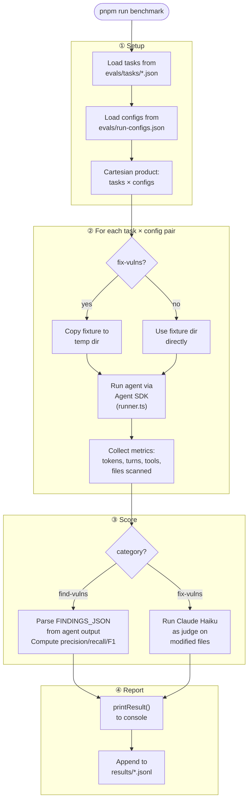

So you're building with AI coding agents and you want to know: is Claude Opus actually better than Sonnet for this task? Does adding a security-specific MCP server improve results? How many tokens does it burn per run, and is that sustainable?

These are benchmarking questions, and "I ran it a few times and it seemed fine" doesn't cut it. You need a systematic harness that runs the same tasks against different configurations, scores the results objectively, and records everything so you can compare across dimensions.

This post walks through building exactly that — a benchmarking framework for AI coding agents, specifically focused on security tasks (find and fix vulnerabilities). I'll share the architecture decisions, the gotchas we hit, and the code you can adapt for your own domain.

Everything here is built on the [Claude Agent SDK](https://github.com/anthropics/claude-agent-sdk) (`@anthropic-ai/claude-agent-sdk`), TypeScript, and Node 24.

---

## What are we benchmarking, exactly?

The benchmark answers three questions for every agent run:

| Question | Metric |
|---|---|
| **Quality** — did it do the right thing? | Score (precision, recall, F1) |
| **Cost** — how expensive was it? | Token counts (4 types), wall time |
| **Behavior** — how did it work? | Tool calls, files scanned, turns taken |

We have two eval categories:

- **find-vulns**: Give the agent a codebase with known vulnerabilities. Ask it to find them. Score it on how many it found vs. how many were real.
- **fix-vulns**: Give the agent the same codebase. Ask it to fix everything. Score it by using another Claude model as a judge to verify the fixes.

You can swap in your own domain — "find bugs", "add tests", "implement a feature from a spec" — the framework is the same regardless.

---

## The overall architecture

Before diving into code, here's the full pipeline:



The key insight is that a "run" is always one `(task, config)` pair. You get a matrix of results. Comparing Opus vs Sonnet on the same task is just two rows in that matrix.

---

## Step 1: The fixtures — intentionally broken code

A fixture is a small codebase with known vulnerabilities. The agent is given this as its working directory.

Here's our Express.js fixture (`fixtures/js-vulns/app.js`):

```javascript
const express = require("express");
const { exec } = require("child_process");
const fs = require("fs");

const DB_CONFIG = {
  host: "localhost",
  user: "admin",
  password: "supersecretpassword123",  // hardcoded credentials
  database: "users_db",
};

app.get("/users", (req, res) => {
  const username = req.query.username;
  const sql = "SELECT * FROM users WHERE username = '" + username + "'";  // SQL injection
  const results = dbQuery(sql);
  res.json(results);
});

app.get("/greet", (req, res) => {
  const name = req.query.name;
  res.send(`<html><body><h1>Hello, ${name}!</h1></body></html>`);  // XSS
});

app.get("/file", (req, res) => {
  const filename = req.query.filename;
  const basePath = "/var/app/public/";
  fs.readFile(basePath + filename, "utf8", (err, data) => {  // path traversal
    res.send(data);
  });
});

app.get("/ping", (req, res) => {
  const host = req.query.host;
  exec("ping -c 1 " + host, (err, stdout) => {  // command injection
    res.send(`<pre>${stdout}</pre>`);
  });
});
```

Five vulnerabilities. Simple enough to be quick to run, complex enough to be non-trivial.

**Critical lesson: strip all comments that reveal the vulnerabilities.** In early development we had `// VULN: SQL injection` style comments all over the code. The agent just reads these and reports them back — not a real test at all. The fixture should look like real production code written by a developer who didn't notice the issues.

### The ground-truth file lives *outside* the fixture directory

This one will bite you if you're not careful.

We store the answer key as `fixtures/js-vulns.json` — a sibling to the fixture directory, not inside it:

```
fixtures/
  js-vulns.json       ← ground truth (agent never sees this)
  js-vulns/           ← agent's working directory
    app.js
```

If you put `vulns.json` inside `js-vulns/`, the agent will just `Read` it and report whatever's in it. Perfect score, zero signal. The answer key must be out of reach.

```json
{
  "description": "Intentionally vulnerable Express.js app",
  "vulnerabilities": [
    {
      "id": "js-sqli-1",
      "type": "sql-injection",
      "severity": "critical",
      "file": "app.js",
      "line": 24,
      "description": "User input directly concatenated into SQL query string"
    },
    ...
  ]
}
```

---

## Step 2: The type system — knowing what you're measuring

Before writing any agent code, define your data model. This forces clarity on what a "task", a "config", and a "result" actually are.

```typescript
// A specific eval scenario: which fixture, which category, what prompt
export interface EvalTask {
  id: string;
  name: string;
  category: EvalCategory;        // "find-vulns" | "fix-vulns"
  fixture: string;               // path to fixture directory
  systemPrompt?: string;
  prompt: string;
  knownVulns: Vulnerability[];   // loaded from fixtures/<name>.json
  maxTurns?: number;
}

// A model + tool configuration to test
export interface RunConfig {
  id: string;
  name: string;
  model: string;                 // e.g. "claude-opus-4-6"
  mcpServers?: Record<string, MCPServerConfig>;
  maxTurns?: number;
}

// Everything collected during one agent session
export interface BenchmarkMetrics {
  sessionDurationMs: number;
  totalInputTokens: number;
  totalOutputTokens: number;
  totalCacheReadTokens: number;        // prompt cache reads (billed at ~10% rate)
  totalCacheCreationTokens: number;    // prompt cache writes (billed at ~125% rate)
  totalTurns: number;                  // unique API calls (after dedup — more on this)
  toolCalls: ToolCallRecord[];
  toolStats: Record<string, ToolStat>;
  filesScanned: string[];              // unique files touched by Read/Write/Edit
}
```

The separation of `EvalTask` and `RunConfig` is deliberate. Tasks define *what* to test; configs define *who* is doing the test. The benchmark is the cartesian product of both.

---

## Step 3: Open/closed task and config loading

You want to add a new fixture or a new model configuration without touching source code. The classic open/closed principle.

Tasks live in `evals/tasks/*.json`:

```json
{
  "id": "js-find-vulns",
  "name": "JS App: Find Vulnerabilities",
  "category": "find-vulns",
  "fixture": "js-vulns",
  "maxTurns": 20
}
```

Configs live in `evals/run-configs.json`:

```json
[
  {
    "id": "opus-4-6",
    "name": "Claude Opus 4.6 (no MCP)",
    "model": "claude-opus-4-6",
    "maxTurns": 30
  },
  {
    "id": "sonnet-4-6",
    "name": "Claude Sonnet 4.6 (no MCP)",
    "model": "claude-sonnet-4-6",
    "maxTurns": 30
  }
]
```

The loader scans both directories at startup and wires everything together:

```typescript
// src/evals/loader.ts
const FIXTURES_DIR = resolve(PROJECT_ROOT, "fixtures");
const TASKS_DIR = resolve(PROJECT_ROOT, "evals/tasks");

export function loadEvalTasks(): EvalTask[] {
  const files = readdirSync(TASKS_DIR).filter(f => f.endsWith(".json")).sort();

  return files.map(file => {
    const taskJson = JSON.parse(readFileSync(join(TASKS_DIR, file), "utf-8"));
    const { id, name, category: categoryId, fixture, maxTurns } = taskJson;

    const category = resolveCategory(categoryId);
    const knownVulns = loadVulns(fixture);        // reads fixtures/<fixture>.json
    const fixturePath = resolve(FIXTURES_DIR, fixture);

    return { id, name, category, fixture: fixturePath, knownVulns, maxTurns,
             systemPrompt: category.defaultSystemPrompt,
             prompt: category.defaultPrompt };
  });
}

function loadVulns(fixtureName: string): Vulnerability[] {
  // Note the path: sibling to fixture dir, not inside it
  const vulnsPath = join(FIXTURES_DIR, `${fixtureName}.json`);
  const raw = JSON.parse(readFileSync(vulnsPath, "utf-8"));
  return raw.vulnerabilities;
}
```

To add a new fixture: create `fixtures/ruby-vulns/app.rb`, create `fixtures/ruby-vulns.json` with the ground truth, drop `evals/tasks/ruby-find-vulns.json`. Done — no code changes.

---

## Step 4: The runner — orchestrating the agent

This is the core of the benchmark. The runner uses the Claude Agent SDK to spin up a Claude Code subprocess, point it at the fixture directory, and collect metrics while it works.

```typescript
import { query, type HookCallback } from "@anthropic-ai/claude-agent-sdk";

export async function runTask(task: EvalTask, config: RunConfig, cwd: string): Promise<RunOutput> {
  const toolCalls: ToolCallRecord[] = [];
  const toolStartTimes = new Map<string, number>();
  const filesScannedSet = new Set<string>();

  // PreToolUse: stamp start time for each tool call
  const preToolHook: HookCallback = async (input) => {
    const id = (input as any).tool_use_id ?? String(Date.now());
    toolStartTimes.set(id, Date.now());
    return {};
  };

  // PostToolUse: record duration, estimate tokens, track files touched
  const postToolHook: HookCallback = async (input) => {
    const id = (input as any).tool_use_id ?? "";
    const tool = (input as any).tool_name ?? "unknown";
    const startTime = toolStartTimes.get(id) ?? Date.now();
    const inputTokensEst = estimateTokens((input as any).tool_input);
    const outputTokensEst = estimateTokens((input as any).tool_response ?? (input as any).tool_result);

    toolCalls.push({ tool, durationMs: Date.now() - startTime, inputTokensEst, outputTokensEst });

    if (tool === "Read" || tool === "Write" || tool === "Edit") {
      const filePath = (input as any).tool_input?.file_path;
      if (filePath) filesScannedSet.add(filePath);
    }
    toolStartTimes.delete(id);
    return {};
  };

  for await (const message of query({
    prompt: task.prompt,
    options: {
      cwd,
      model: config.model,
      maxTurns: task.maxTurns ?? config.maxTurns ?? 30,
      allowedTools: [
        "Read", "Glob", "Grep", "Bash", "Write", "Edit",
        ...Object.keys(config.mcpServers ?? {}).map(name => `mcp__${name}__*`),
      ],
      permissionMode: "bypassPermissions",
      systemPrompt: task.systemPrompt,
      sandbox: {
        filesystem: {
          allowWrite: [cwd],          // agent can only write inside fixture dir
          denyRead: [dirname(cwd)],   // agent cannot read parent dir (where answer key lives)
        },
      },
      hooks: {
        PreToolUse:  [{ matcher: ".*", hooks: [preToolHook] }],
        PostToolUse: [{ matcher: ".*", hooks: [postToolHook] }],
      },
    },
  })) {
    // ... accumulate tokens (with a crucial caveat, see below)
  }
}

function estimateTokens(value: unknown): number {
  if (value == null) return 0;
  return Math.ceil(JSON.stringify(value).length / 4);
}
```

A few things worth unpacking here.

### Sandboxing the agent

By default, Claude Code can read and write anywhere on the filesystem. For a benchmark this is a problem: the agent might stumble on the answer key (the `fixtures/js-vulns.json` file that lives one directory up from its working directory) and read it.

The `sandbox.filesystem` option closes this:
- `allowWrite: [cwd]` — writes are whitelisted to the fixture dir only
- `denyRead: [dirname(cwd)]` — reading the parent directory (which contains the answer key) is blocked

Without this, the agent can cheat and your scores are meaningless.

### MCP tools need explicit allow-listing

If your `RunConfig` includes MCP servers, their tools won't work unless you explicitly allow them. The `allowedTools` array is the complete whitelist — everything else is blocked.

The pattern `mcp__<server-name>__*` grants all tools from a server. We auto-derive it from `config.mcpServers` keys so adding a new server in the JSON config is enough:

```typescript
...Object.keys(config.mcpServers ?? {}).map(name => `mcp__${name}__*`)
```

---

## Step 5: Getting token counts right (there are gotchas)

This took some debugging to get right. Let me save you the pain.

### Bug 1: Reading usage from the wrong message

The Agent SDK's `query()` iterator yields several message types. The `ResultMessage` at the end has a `usage` field — but it only contains the cost of that final tiny "done" turn, not the session total. If you read from there, you'll get something like `in: 7, out: 3` for a 50-turn session. Completely wrong.

The correct approach: accumulate from every `AssistantMessage`:

```typescript
// ✗ Wrong — ResultMessage.usage is just the final turn, not cumulative
if ("result" in message) {
  totalInputTokens = message.usage.input_tokens; // overwrites all accumulated data!
}

// ✓ Correct — accumulate from every assistant turn
if (message.type === "assistant") {
  const usage = (message as any).message?.usage;  // note: .message.usage, not .usage
  if (usage) {
    totalInputTokens += usage.input_tokens ?? 0;
    totalOutputTokens += usage.output_tokens ?? 0;
    totalCacheReadTokens += usage.cache_read_input_tokens ?? 0;
    totalCacheCreationTokens += usage.cache_creation_input_tokens ?? 0;
  }
}
```

Also note: `usage` is at `message.message.usage`, not `message.usage`. The SDK wraps the raw API response in a `.message` property.

### Bug 2: The SDK fires multiple events per API call

This one is subtle. The Agent SDK emits one `SDKAssistantMessage` event **per content block** in an API response — not one per API call.

If Claude returns a response with both a `thinking` block and a `tool_use` block, the SDK fires two events, each carrying the *same* `usage` object:

```
API response:  content=[thinking, tool_use]  usage={in:3, out:54, cr:9845}

SDK emits:
  SDKAssistantMessage #1  content=[thinking]  usage={in:3, out:54, cr:9845}
  SDKAssistantMessage #2  content=[tool_use]  usage={in:3, out:54, cr:9845}
```

If you naively accumulate `usage.output_tokens` on every event, those 54 tokens get counted twice. The API billed you once; you counted twice.

The fix: track the last-seen usage fingerprint per session level, only accumulate when it changes.

```typescript
const lastUsagePerSession = new Map<string | null, string>();

if (message.type === "assistant") {
  const usage = (message as any).message?.usage;
  if (usage) {
    // parent_tool_use_id identifies which session level this message belongs to
    // (null = root session, non-null = sub-agent session)
    const sessionKey: string | null = (message as any).parent_tool_use_id ?? null;
    const usageKey = `${usage.input_tokens}:${usage.output_tokens}:${usage.cache_read_input_tokens}:${usage.cache_creation_input_tokens}`;

    if (lastUsagePerSession.get(sessionKey) !== usageKey) {
      lastUsagePerSession.set(sessionKey, usageKey);
      totalTurns++;
      totalInputTokens += usage.input_tokens ?? 0;
      // ... etc
    }
  }
}
```

The `parent_tool_use_id` field also handles sub-agent sessions. When Claude uses the built-in `Agent` tool to spawn a nested sub-agent, that sub-session's messages stream through the same iterator but with `parent_tool_use_id` set. We want to count their tokens (real API cost) but deduplicate correctly within each session level.

### Understanding the four token fields

The Anthropic API reports four token types. They have different billing rates and mean different things:

```
Turn 1: system prompt + user message
  input_tokens:                 3    ← new non-cached tokens (full input rate)
  cache_creation_input_tokens:  2521 ← written to cache (~125% of input rate)
  cache_read_input_tokens:      7324 ← served from cache (~10% of input rate)
  output_tokens:                8    ← Claude's generated tokens (output rate)

Turn 2: tool results added
  input_tokens:                 1    ← almost nothing new (everything else cached)
  cache_creation_input_tokens:  3557 ← new tool results get cached
  cache_read_input_tokens:      9845 ← growing cache serves prior context
  output_tokens:                46
```

The `input_tokens` field is *only* the new non-cached tokens per turn. With prompt caching active (which happens automatically when the prefix is >1,024 tokens), almost all context is served from cache — so `input_tokens` might be 1–3 tokens per turn while `cache_read_input_tokens` grows to hundreds of thousands.

**The total shown in the report (`Tokens: N total`) adds all four fields.** This is "total context consumed", not cost — because cache reads bill at 10% and cache writes at 125%, the actual dollar cost requires weighting each field by its rate.

---

## Step 6: Scoring

### find-vulns: structured output + matching

The system prompt tells the agent to end its response with a JSON block:

```
FINDINGS_JSON:
```json
[
  {
    "type": "sql-injection",
    "file": "app.js",
    "line": 24,
    "severity": "critical",
    "description": "User input concatenated into SQL query"
  }
]
```
```

The scorer parses this and matches against the ground truth by vulnerability type:

```typescript
export function scoreFindVulns(agentOutput: string, task: EvalTask): FindVulnsDetails {
  const agentFindings = parseFindings(agentOutput);
  const knownVulns = task.knownVulns;

  const truePositives: string[] = [];
  const matchedKnownIds = new Set<string>();

  for (const found of agentFindings) {
    // Match by type — normalize aliases ("SQL Injection" → "sql-injection")
    const match = knownVulns.find(
      kv => !matchedKnownIds.has(kv.id) && vulnTypesMatch(kv.type, found.type)
    );
    if (match) {
      truePositives.push(match.id);
      matchedKnownIds.add(match.id);
    }
  }

  const falsePositives = agentFindings.length - truePositives.length;
  const falseNegatives = knownVulns.filter(kv => !matchedKnownIds.has(kv.id)).map(kv => kv.id);
  const precision = agentFindings.length === 0 ? 0 : truePositives.length / agentFindings.length;
  const recall = knownVulns.length === 0 ? 1 : truePositives.length / knownVulns.length;

  return { agentFindings, truePositives, falsePositives, falseNegatives, precision, recall };
}

// F1: harmonic mean of precision and recall
export function findVulnsScore(details: FindVulnsDetails): number {
  const { precision, recall } = details;
  if (precision + recall === 0) return 0;
  return (2 * precision * recall) / (precision + recall);
}
```

Why F1? Precision alone rewards being conservative (report nothing, zero false positives, but terrible recall). Recall alone rewards crying wolf (report everything, 100% recall, but terrible precision). F1 penalizes both and gives you a single headline number.

The type normalization is important — models use different aliases for the same vulnerability class. We maintain a map:

```typescript
const map: Record<string, VulnType> = {
  "sql injection": "sql-injection",
  "cross-site scripting": "xss",
  "directory traversal": "path-traversal",
  "rce": "command-injection",
  "hardcoded secret": "hardcoded-credentials",
  // ...
};
```

### fix-vulns: LLM-as-judge

For fix-vulns, the agent modifies files — there's no structured output to parse. Instead, after the agent run, we read the modified fixture and ask Claude Haiku to judge whether each vulnerability was fixed:

```typescript
export async function scoreFixVulns(fixedDir: string, task: EvalTask): Promise<FixVulnsDetails> {
  const files = gatherSourceFiles(fixedDir);
  const codeContext = files
    .map(({ path, content }) => `### ${path}\n\`\`\`\n${content}\n\`\`\``)
    .join("\n\n");

  const vulnList = task.knownVulns
    .map(v => `- ${v.id}: ${v.type} in ${v.file} — ${v.description}`)
    .join("\n");

  const response = await anthropic.messages.create({
    model: "claude-haiku-4-5",
    max_tokens: 1024,
    messages: [{
      role: "user",
      content: `You are a security code reviewer. The following code has been modified to fix vulnerabilities.

Original vulnerabilities:
${vulnList}

Modified code:
${codeContext}

For each vulnerability, determine if it has been fixed. Respond with JSON:
{ "results": [{ "id": "vuln-id", "fixed": true/false, "note": "brief explanation" }] }`
    }],
  });

  // parse results, count fixes
  const fixedCount = results.filter(r => r.fixed).length;
  return {
    vulnsAttempted: task.knownVulns.length,
    vulnsFixed: fixedCount,
    judgeNotes: results.map(r => `${r.id}: ${r.fixed ? "✓" : "✗"} ${r.note}`).join("; "),
  };
}
```

We use Haiku for the judge because it's cheap and fast — the judge call is overhead on top of the actual agent run. For fix-vulns, the score is simply `vulnsFixed / vulnsAttempted`.

The fix-vulns runner always works on a *temp copy* of the fixture so the originals are never modified:

```typescript
if (task.category.id === "fix-vulns") {
  cwd = join(TMP_DIR, `${task.id}-${config.id}-${Date.now()}`);
  mkdirSync(cwd, { recursive: true });
  cpSync(task.fixture, cwd, { recursive: true });
  cleanupTmp = true;
}
```

---

## Step 7: The reporter

The output for a single run looks like this:

```
──────────────────────────────────────────────────────────────────────
Task:    JS App: Find Vulnerabilities
Config:  Claude Sonnet 4.6 (no MCP)
Score (F1): 91%
Tokens:  74,757 total  (in: 271, out: 134  cache-read: 65,172, cache-write: 9,180)
Time:    55.2s  |  Turns: 5  |  Files: 11

Recall:    100%  (5/5 known vulns found)
Precision: 83%   (1 false positives)
Missed:    none

All tools:  (12 calls across 2 tool types)
  Read: 11x, avg 6ms, ~242 in / ~2,558 out tokens (est)
  Bash: 1x, avg 595ms, ~35 in / ~2,219 out tokens (est)
```

Note the `Score (F1):` label — for find-vulns, the score is an F1; for fix-vulns, it's a fix rate. Making this explicit in the label avoids confusion when reading results.

The summary table at the end compares all runs side by side:

```
══════════════════════════════════════════════════════════════════════
BENCHMARK SUMMARY
══════════════════════════════════════════════════════════════════════
Task             Config      Score  Tokens   Time(s)
───────────────  ──────────  ─────  ───────  ───────
js-find-vulns    opus-4-6    91%    183,221  45.2
js-find-vulns    sonnet-4-6  83%    74,757   55.2
python-find-vulns opus-4-6   85%    201,400  52.1
python-find-vulns sonnet-4-6 78%    91,223   61.3
```

Each run is also appended to a JSONL file (`results/benchmark-<timestamp>.jsonl`) for post-hoc analysis:

```bash
# Which config had the best recall?
jq 'select(.details.recall != null) | {config: .runConfigId, recall: .details.recall}' results/*.jsonl

# Total cost across all runs (rough)
jq '.metrics | (.totalInputTokens * 3 + .totalOutputTokens * 15 + .totalCacheReadTokens * 0.3 + .totalCacheCreationTokens * 3.75) / 1000000' results/*.jsonl
```

---

## Step 8: Putting it all together — the CLI

The entry point wires everything up:

```typescript
async function main() {
  const opts = parseArgs();        // --task, --config, --category, --dry-run
  const tasks = loadEvalTasks();
  const configs = loadRunConfigs();

  // Filter based on CLI flags
  const filteredTasks = tasks
    .filter(t => !opts.task || t.id === opts.task)
    .filter(t => !opts.category || t.category.id === opts.category);
  const filteredConfigs = configs
    .filter(c => !opts.config || c.id === opts.config);

  // Print the plan
  console.log(`Benchmark: ${filteredTasks.length} task(s) × ${filteredConfigs.length} config(s) = ${filteredTasks.length * filteredConfigs.length} run(s)`);
  for (const task of filteredTasks) {
    console.log(`  ${task.id}  [${task.category.id}]`);
    for (const config of filteredConfigs) {
      console.log(`    └─ ${config.id}: ${config.model}`);
    }
  }

  if (opts.dryRun) { console.log("\nDry run — exiting."); return; }

  // Run the matrix
  const results: EvalResult[] = [];
  for (const config of filteredConfigs) {
    for (const task of filteredTasks) {
      const result = await runEval(task, config);
      printResult(result);
      results.push(result);
    }
  }

  printSummaryTable(results);
  const path = saveResults(results, RESULTS_DIR);
  console.log(`\nResults saved to: ${path}`);
}
```

The `package.json` scripts make it easy to run slices of the benchmark:

```json
{
  "scripts": {
    "benchmark": "tsx src/index.ts",
    "benchmark:find": "tsx src/index.ts --category find-vulns",
    "benchmark:fix": "tsx src/index.ts --category fix-vulns",
    "benchmark:find:js": "tsx src/index.ts --task js-find-vulns --config sonnet-4-6"
  }
}
```

---

## The metrics that matter

Here's a quick reference for everything the benchmark measures:

### Quality (find-vulns)

| Metric | What it tells you |
|---|---|
| **Recall** | Did the agent miss anything? 100% = found every real vuln |
| **Precision** | Did it cry wolf? 100% = every finding was a real vuln |
| **F1 Score** | Balances both — the headline number for comparison |
| **False positives** | How noisy is the agent? |
| **False negatives** | Which specific vulns did it miss? |

### Quality (fix-vulns)

| Metric | What it tells you |
|---|---|
| **Vulns fixed / attempted** | Simple fix rate |
| **Judge notes** | Per-vulnerability verdict with brief explanation |

### Session cost & behavior

| Metric | What it tells you |
|---|---|
| **Wall time** | How long did the whole session take? |
| **Turns** | How many API calls? (after dedup — see above) |
| **Files scanned** | How much of the codebase did it explore? |
| **in / out tokens** | New non-cached input and generated output |
| **cache-read tokens** | Repeated context served cheaply from cache |
| **cache-write tokens** | New content being cached for future turns |
| **Tool calls / types** | What tools, how many times, how fast |
| **Per-tool token estimates** | Which tools consume the most context? |

---

## Things that surprised us

**Prompt caching dominates the token counts.** In a 5-turn session, we saw `in: 271, out: 134, cache-read: 65,172`. The session consumed 65,172 tokens total but only 405 were "new" — the rest were cached. This is expected behavior, but it means "total tokens" is not a simple cost proxy.

**The Agent SDK fires multiple events per API response.** This wasn't documented anywhere we could find. A single API call that returns `[thinking, tool_use]` fires two `SDKAssistantMessage` events with identical usage. If you don't deduplicate, every metric is inflated by 2–6×.

**Answer key isolation matters more than you think.** We tested with the vulns.json inside the fixture directory before catching this. Claude immediately reads every JSON file in its working directory as part of its initial exploration. It doesn't know the file is supposed to be the answer key — it just reads whatever's there.

**Comments in fixture code completely invalidate results.** Having `// VULN: SQL injection` in your code is the same as handing the agent the answer sheet. The fixture should read like real code written by a developer who didn't notice the issues.

**F1 is the right headline metric, but watch the components.** An agent can score 56% F1 with 100% recall and 38% precision — it found everything but hallucinated 8 extra vulnerabilities. A different agent might score 56% F1 with 56% recall and 56% precision — it found about half and was accurate. Same F1, very different behavior. Always look at recall and precision separately.

---

## Where to take it from here

This framework is intentionally minimal — it does one thing well. Some directions worth exploring:

**More fixture types.** We have JavaScript and Python. Ruby, Go, Java, PHP are all easy additions. The loader picks up new tasks automatically from the JSON files.

**MCP server comparison.** The `RunConfig` supports MCP servers natively. Add a config with a security-focused MCP server (Snyk, Semgrep, etc.) and compare its F1 against the baseline. That's one JSON entry.

**Replace the Agent SDK with a direct API loop.** The current runner depends on the Claude Code CLI being installed. An alternative is to build the agentic loop directly against `@anthropic-ai/sdk`: call `messages.create()` in a loop, implement tools (Read, Glob, Grep, Bash, Write, Edit) as local functions, feed results back as `tool_result` blocks. No CLI dependency, full control over every hook and metric. The main unknowns are whether MCP server support is available without the CLI and how to replicate the per-tool timing hooks.

**Scoring variants.** The current find-vulns scorer matches by vulnerability type only. You could add file-level matching (bonus points for finding the right file), severity weighting (critical vulns count more), or partial credit for finding a related but not exact type.

The full source is organized like this:

```
src/
  types.ts          # All interfaces — start here
  runner.ts         # Agent SDK wrapper + metrics collection
  scorer.ts         # Precision/recall/F1 and LLM judge
  reporter.ts       # Console output + JSONL
  evals/
    loader.ts       # Scans evals/tasks/*.json + evals/run-configs.json
  index.ts          # CLI entry point

evals/
  tasks/            # One JSON per eval task — add here to add a task
  run-configs.json  # Array of RunConfig objects

fixtures/
  js-vulns.json     # Ground truth (outside agent cwd!)
  js-vulns/         # Agent's working directory
    app.js
```

Happy benchmarking.
