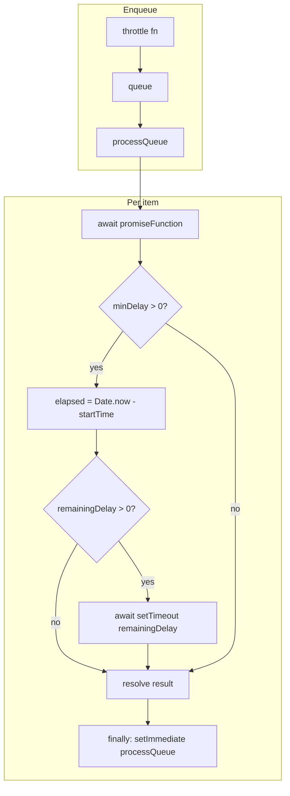

So you're asserting `Date.now()` deltas around `setTimeout`, CI is green on two Node versions, and the matrix job for the middle version explodes with `Expected: >= 100` and `Received: 99`. Nothing in your product code changed. The failure isn't every run. That's the kind of bug that wastes an afternoon unless you know what you're measuring.

I hit this on [npq](https://github.com/lirantal/npq) while tightening promise throttling for package audits. We fixed it by stopping wall-clock assertions for timer behavior and driving the same scenarios with Jest fake timers. This post is the anatomy of that flake: why it happens, how the throttler actually behaves, and how I'd write the tests again from scratch.

## What we're actually testing

| What you think you're testing | What the CPU is really doing |
|------------------------------|------------------------------|
| "At least 100ms passed" | Integer ms from `Date.now()` before and after async work |
| "setTimeout(100) means 100ms" | The host schedules a timer; wakeups aren't aligned to your test's two `Date.now()` samples |
| "One failing Node = Node bug" | Often it's your test assuming properties the runtime never promised |

The throttler's job is simple: cap concurrency and enforce a **minimum** spacing between handled requests. The tests need to prove (1) fast work still waits for `minDelay`, and (2) slow work does **not** get an extra `minDelay` stacked on top. Wall-clock ms are the wrong instrument for both.

## Architecture overview



`processQueue` is async and re-entrant via `setImmediate`, but the flaky tests only cared about the **`Date.now` / `setTimeout`** slice in the middle: measure elapsed work, then sleep the remainder of `minDelay`. That's where test time and real time diverge.

## Step 1: The production path — why `99` is not always a bug

The implementation (simplified) looks like this:

```javascript
const startTime = Date.now()
const result = await promiseFunction()

if (this.minDelay > 0) {
  const elapsed = Date.now() - startTime
  const remainingDelay = this.minDelay - elapsed
  if (remainingDelay > 0) {
    await new Promise((r) => setTimeout(r, remainingDelay))
  }
}
```

Two separate issues bite you:

1. **`elapsed` can be `1` even when work feels instant.** Two `Date.now()` calls can straddle a clock tick. Then `remainingDelay = 100 - 1` → **`setTimeout(..., 99)`**. Your outer test that wraps the whole `throttle()` in `Date.now()` still expects ≥ 100 ms. The code is doing what the math says; the test assumed "minDelay 100 ⇒ at least 100 ms wall."

2. **`setTimeout(100)` does not promise a ≥ 100 ms delta in `Date.now()`.** Resolution is coarse. The event loop can fire the timer such that `end - start === 99`. That's intermittent, which is why you see it on one Node version and not others — different timer internals, same brittle assertion.

So the first learning: **a red test here often indicts the test, not the throttler.**

## Step 2: The wrong test (what we shipped first)

```javascript
// ✗ Wrong — wall-clock, flaky on Node 22 CI
test('should respect minimum delay between requests', async () => {
  const throttler = new PromiseThrottler()
  throttler.configure(5, 100)

  const startTime = Date.now()
  const mockPromise = jest.fn().mockResolvedValue('result')

  await throttler.throttle(mockPromise)
  const endTime = Date.now()

  expect(endTime - startTime).toBeGreaterThanOrEqual(100)
})
```

This reads clearly. It also couples the assertion to **real time**, OS scheduling, and `Date.now()` quantization. CI machines disagree with your laptop; Node 22 disagrees with 20 and 24.

## Step 3: Fake timers for "must wait minDelay" (fast promise)

You want to prove: **if the promise resolves immediately, the throttler still waits until `minDelay` worth of time has passed.** Under Jest, that means controlling the clock.

```javascript
// ✓ Correct — behavioral, deterministic
test('should respect minimum delay between requests', async () => {
  jest.useFakeTimers({ now: Date.now() })
  try {
    const throttler = new PromiseThrottler()
    throttler.configure(5, 100)

    const mockPromise = jest.fn().mockResolvedValue('result')
    const finished = throttler.throttle(mockPromise)

    await Promise.resolve()
    await jest.advanceTimersByTimeAsync(100)
    await finished

    expect(mockPromise).toHaveBeenCalledTimes(1)
  } finally {
    jest.useRealTimers()
  }
})
```

Notes that matter:

- **`useFakeTimers({ now: Date.now() })`** — avoids starting at epoch 0 if anything logs or compares absolute times.
- **`await Promise.resolve()`** — lets the microtask queue run so the mocked promise resolves and the internal `setTimeout(remainingDelay)` is scheduled before you advance.
- **`finally { jest.useRealTimers() }`** — the same file has tests that use **real** `setTimeout` (e.g. a deliberate 100 ms slow promise). If you leave fake timers on, you'll break those tests in confusing ways.

## Step 4: The second flake — "no extra delay" with a slow promise

After we fixed Step 3, CI still failed on the sibling test: same pattern, `>= 100` vs `99`, but this time the slowness came from **`setTimeout(..., 100)` inside the mocked work**, not from `minDelay`.

```javascript
// ✗ Wrong — same wall-clock pitfall, different test name
test('should not add extra delay if promise already took longer than minDelay', async () => {
  const throttler = new PromiseThrottler()
  throttler.configure(5, 50)

  const startTime = Date.now()
  const slowPromise = jest.fn().mockImplementation(
    () => new Promise((resolve) => setTimeout(() => resolve('result'), 100))
  )

  await throttler.throttle(slowPromise)
  const endTime = Date.now()

  expect(endTime - startTime).toBeLessThan(130)
  expect(endTime - startTime).toBeGreaterThanOrEqual(100)
})
```

The intent: work takes ~100 ms; `minDelay` is 50 ms; **`elapsed > minDelay`** so the throttler should **not** add another 50 ms (total would drift toward ~150 ms). The upper bound (`< 130`) was trying to guard that. The lower bound (`>= 100`) still used wall-clock ms around the same flaky boundary.

Fix: run that slow work under the **same** fake clock and assert **exactly** how much virtual time passed. If the throttler incorrectly waited an extra 50 ms, you'd need **`advanceTimersByTimeAsync(150)`** to finish — or `jest.now()` would jump by 150 when you did advance.

```javascript
// ✓ Correct — fake time must be 100ms total, not ~150ms
test('should not add extra delay if promise already took longer than minDelay', async () => {
  jest.useFakeTimers({ now: Date.now() })
  try {
    const throttler = new PromiseThrottler()
    throttler.configure(5, 50)

    const slowPromise = jest.fn().mockImplementation(
      () => new Promise((resolve) => setTimeout(() => resolve('result'), 100))
    )

    const startedAt = jest.now()
    const finished = throttler.throttle(slowPromise)

    await Promise.resolve()
    await jest.advanceTimersByTimeAsync(100)
    await finished

    expect(jest.now() - startedAt).toBe(100)
    expect(slowPromise).toHaveBeenCalledTimes(1)
  } finally {
    jest.useRealTimers()
  }
})
```

Here `jest.now()` is the fake clock's idea of time. After a single 100 ms advance, the throttle promise should be done, and the clock should read **100 ms later** — not 150.

## Step 5: Best practices I'd enforce in code review

1. **Don't use `Date.now()` or `performance.now()` to unit-test timer behavior.** Use fake timers, or spy on `setTimeout` and assert delay arguments and call counts, or extract a `clock`/`sleep` dependency and inject a test double.

2. **Scope fake timers narrowly.** `try` / `finally` with `useRealTimers()` per test (or per `describe` if every test in the block is timer-driven). Mixing fake and real timers in one file without resetting is a common source of "passes alone, fails in full suite."

3. **Flush microtasks before `advanceTimersByTimeAsync`.** The pattern `await Promise.resolve()` (sometimes twice) is boring but reliable — without it, you race the scheduler.

4. **When production uses `Date.now()` for elapsed work, your test's wall-clock span is not the same variable.** The implementation measures time **inside** `processQueue` around `await promiseFunction()`. Your test's outer `Date.now()` includes queue setup, microtasks, and `setImmediate` churn. You're not even asserting the same interval.

5. **Relaxing `>= 100` to `>= 99` is a band-aid.** It doesn't fix the category error (wall clock vs. behavior), and it makes regressions easier to sneak in.

## Things that surprised us

**The first green fix didn't kill CI.** We only converted the "minimum delay" test. The "no extra delay" test still used real timers and the same `>= 100` assertion. Same failure mode, different test name. If you fix one flaky timer test in a file, grep for `Date.now()`, `performance.now()`, and bare `setTimeout` expectations in the rest of the suite.

**A "strict" fake-timer sequence of `advance(minDelay - 1)` then `advance(1)` is wrong if production schedules `setTimeout(99)`.** When `elapsed` is 1 ms, `remainingDelay` is 99. Advancing 99 ms already fires the timer — so asserting "not settled after 99 ms" fails. We used "advance 100 then await" for the fast-path test instead of over-fitting to a single internal delay value.

**Node version skew made the flake feel like a platform bug.** 20 and 24 passed; 22 failed. That's a signal to distrust the test harness, not to bisect the Node changelog first. Timer and `Date.now()` coupling really is version- and load-sensitive.

**Jest's fake `Date.now()` and `jest.now()` move together when configured.** That's what makes `jest.now() - startedAt === 100` a valid stand-in for "no extra 50 ms" in the slow-work scenario — the throttler's internal `Date.now()`-based `elapsed` sees the same virtual timeline.

## Where to take it from here

- **Inject a clock** — `({ now, schedule })` passed into the throttler — so production and tests share one abstraction and you can unit-test without Jest timer mocks at all.
- **Property-style tests** — generate random `minDelay` / work durations under fake time and assert invariants (never negative sleep, total virtual time within bounds).
- **Audit other packages** — search your org for `toBeGreaterThanOrEqual(10` and `Date.now()` in the same test; you'll find more of these.
- **Document CI matrix policy** — if you test multiple Node versions, timer tests are where you'll feel the spread first; fake timers keep the matrix informative instead of noisy.
