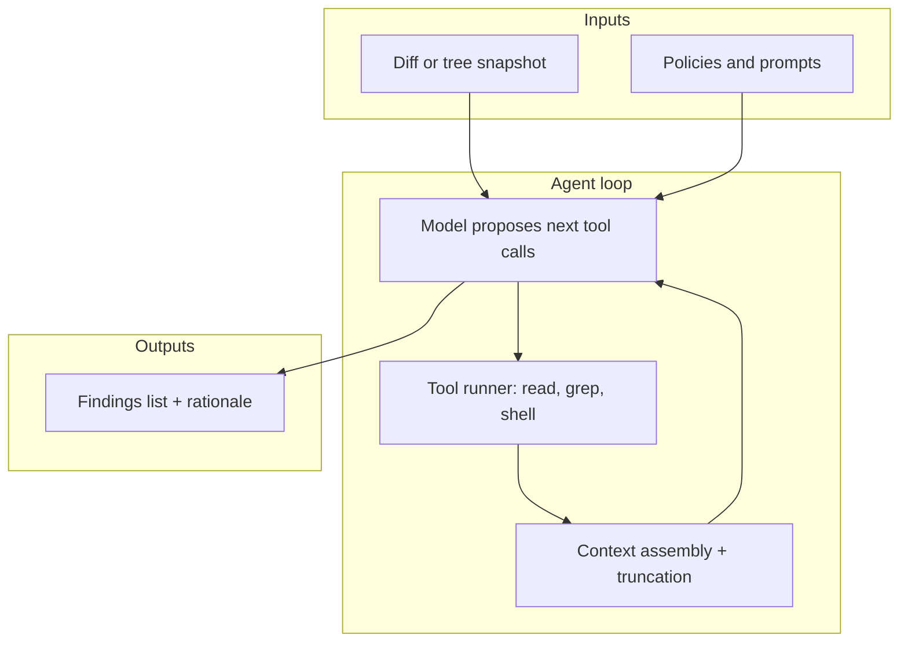

If your team is wiring a coding agent with a `/security-review` or `/security-scan` custom command, you are not alone. The idea is intuitive: point an LLM at a repository, let it read files, grep for suspicious patterns, and emit a punch list of vulnerabilities before merge. In practice, that workflow inherits properties of probabilistic models and agentic control loops that static analysis vendors spent years sanding down.

In this article, I document six structural failure modes, connect them to measurement ideas you can reuse in engineering reviews, and ground one of the scarier claims about "secured" code in peer-reviewed evidence.

You should read this as a scope guardrail, not a dismissal of LLM-assisted review. Used well and with the right contextual information, models compress context and suggest hypotheses. Used as the sole gate, they reintroduce variance where security programs usually demand repeatability, provenance, and budgets that survive every commit.

## Background and prior art

Security engineering has long split work between human review, dynamic analysis, dependency and license scanning, and rule-driven static analysis (SAST). Those tools are not always perfect, but they are engineered for repeatability: the same inputs yield the same findings modulo explicit versioning rules, and incremental scans reuse prior graphs where products support it. Academic benchmarks and industry incident data also emphasize that **correctness and security are distinct**: code can pass functional tests and still admit exploits when threat models change.

Large language models inverted part of that story. They excel at open-ended synthesis and contextual reasoning (potentially at a cross-file reasoning too, but yet to be determined), which is exactly what security reviewers do informally. Benchmarks at function level looked encouraging early on, which nudged teams toward "LLM as scanner" mental models. **BaxBench** (discussed later) is one of the newer checks on that optimism: it evaluates multi-file backend generation with functional tests **and** expert-authored exploits, reporting that even strong models leave a large slice of "correct" programs exploitable.

This write-up focuses on **agent harnesses**—prompted workflows that loop tools, accumulate context, and terminate with a report, because that is what most `/security-scan` implementations are in practice from a developer perspective (inclusive of AI builders, and mature AI native engineers).

## How it works: the anatomy of an agentic security pass

Operationally, a coding agent performing repository-scale review is a feedback system. The model proposes actions (read a path, search for a string, run a command), the harness (e.g: Claude Code or Cursor) executes them, results return as tokens, and the loop continues until a stop condition. That architecture is powerful and flexible, but it couples three sources of variability: the model’s policy, the tool surface exposed to it, and nondeterministic decoding.

Two consequences follow immediately. First, the **state** the model sees is partial and path-dependent: a different ordering of reads can change the final narrative, even if the repository is identical. Second, **cost and latency scale with the loop**, not with a precomputed program representation the way mature SAST engines do after indexing.

The sections below translate those mechanics into product-level risks.

## 1. Run drift: the same command, a different report

Run the same `/security-scan` twice on an unchanged tree. If you treat the output like a compiler, you expect bitwise stability. LLM decoders do not offer that contract unless you build a deterministic harness on top (fixed model version, temperature zero where exposed, pinned prompts, constrained tool plans, and often still residual variance). In real coding agents, temperature and sampling parameters are frequently **not** exposed to end users, and tool ordering can differ between sessions.

**Run drift** is the security program name for that instability. It shows up in triage as contradictory severities, disappearing findings, or new "criticals" that no commit introduced. Teams respond by re-running scans "until it looks right," which is harmless for creative writing and toxic for evidence chains. If you cannot reproduce a finding on demand, you cannot assign accountability, prioritize fairly, or defend an audit trail.

**Quick check:** pick three commits, run the harness five times each at the same commit SHA, and record finding identifiers (CWE, file path, line span). Compare overlap with a simple set metric such as Jaccard similarity across runs. If similarity is low while the tree is fixed, you are measuring entertainment, not instrumentation.

## 2. Phantom findings and the precision–recall trap

Confabulation, often called "hallucination" in casual writing, is not only poetic license. In security triage, it maps cleanly onto classic information retrieval metrics that many software engineers have seen on dashboards, even if the ML vocabulary is unfamiliar.

- **Recall** answers: of all the real security issues present, how many did we flag? High recall means you catch most true vulnerabilities, possibly at the cost of noise.
- **Precision** answers: of everything we flagged, how many were real? High precision means few false alarms, possibly at the cost of misses.

Let's make this concrete: suppose a module contains one true SQL injection vulnerability and ten harmless string concatenations. If a static application security testing (SAST) scanner flags all eleven as issues, its recall is perfect (it finds the real bug) but its precision is poor (only 1 out of 11 flags is correct, so there are many false positives). Now, consider a scanner that "stays silent", meaning it produces no results at all for this analysis. In this scenario, its precision is technically perfect since it never produces false alarms (there are zero false positives among its zero findings). However, its recall is catastrophic because it completely misses the real SQL injection issue. This underscores how high precision alone doesn't mean the tool is useful. If the scanner never reports anything, it's simply blind to real problems.

LLM-generated findings often degrade **precision** without guaranteeing recall. A model can narrate a plausible CWE chain for code that never executed the vulnerable path, cite a library version that is not in your lockfile, or describe an exploit that does not compile. If engineers do not treat those items as hypotheses, the failure mode is worse than ignoring the scan: you pay implementation tax on ghosts: extra branches, user-visible friction, refactors that introduce regressions, all because a non-issue was packaged with confident language.

Note: a potential mitigation for future benchmarks might be to require every automated finding to carry a minimal proof sketch: inputs, trust boundary, and a failing test or exploit scaffold. If the harness cannot produce that artifact, route the item to human review with an explicit "unverified" state rather than a backlog of presumed truth.

## 3. The latency cliff: agent loops versus deterministic scanners

Static analysis products optimize for throughput: parse once, reuse facts, diff against prior graphs, stream results. Agentic review optimizes for flexibility: each step pays round-trip latency and tokenization costs. On a moderate multi-package repository, a single agent pass that reads broadly, follows imports, and reasons aloud can take **minutes**, not seconds, before you even discuss fixing anything. That is not a moral failing; it is physics given current architectures.

Where this hurts is **inner loop ergonomics**. Developers already batch pre-push checks to stay inside attention budgets. If your "scanner" is slower than the test suite and competes for the same CI concurrency slots, it will be skipped on hot paths. Security programs degrade when controls migrate to the paths of least resistance.

Note: potential method to explore is to time-box the harness and log wall-clock duration, tool call counts, and tokens per stage. Compare against your fastest deterministic checks on the same diff. The comparison is not to crown a winner, it is to decide which gates belong on every commit versus nightly evidence generation.

## 4. Unbounded cost: no baseline, no delta, every run bills

Commercial SAST often ships incremental scanning: changed files, cached facts, deduplicated rules. Agentic scans, unless you engineer caching yourself, tend to **re-pay** full context costs on every invocation. Tokens, compute, and seat-time add up even when the code did not change.

The happy path story is seductive: spending thousands of dollars to catch one remote code execution can be rational in isolation. The unhappy path dominates routine engineering: repeated scans across branches and CI matrices spend budget rediscovering that nothing new appeared. Without explicit baselines, deduplication, and change-aware scheduling, finance and developer experience both erode.

Treat LLM review like an expensive microscope, not a smoke detector. Run it where marginal information is highest—large refactors, new auth surfaces, unfamiliar dependencies, and pair it with cheap always-on checks for known patterns.

## 5. BaxBench and why "correct enough" code still gets exploited

When people quote alarming percentages about LLMs writing vulnerable code, it is worth anchoring the claim to a reproducible benchmark instead of vibes. [BaxBench](https://baxbench.com/), introduced by Vero et al., evaluates LLMs on **392** security-critical backend generation tasks spanning multiple frameworks and languages. Solutions are judged with functional tests and with expert-authored exploits executed end to end, including black-box attacks (for example malicious queries) and white-box checks (for example secrets in artifacts).

The paper’s abstract states that, **on average, exploits could be executed on around half of the correct programs** produced by each LLM, a statistic that is easy to misread, so note the denominator: **correct** programs that passed functional tests, not "all outputs." The BaxBench site additionally summarizes that a large share of solutions from even the best models are **either incorrect or contain a vulnerability** (their headline figure is about **62%** for the strongest model in that combined bucket). For model-by-model nuance, use the public **"% insecure of correct"** column on the BaxBench leaderboard rather than a single rounded number pulled from memory.

That is not the same experimental setup as "an LLM patched a finding and we measured patch quality," but it is directly relevant to the thesis of this article. **Code that looks reviewed can remain exploitable** because models optimize for plausibility under incomplete constraints. BaxBench also highlights ecosystem effects: performance degrades further on less popular frameworks, which matches what teams see when agents stray from well-trodden Stack Overflow–shaped paths.

To validate this yourself, read the paper’s methodology section for threat-model assumptions, then inspect the public dataset and harness on Hugging Face and GitHub if you want to reproduce leaderboard numbers rather than trusting a single blog paragraph. Start from the canonical abstract on arXiv and the authors’ site.

## 6. Findings variance: models, prompts, harnesses, and modes all move

Even if you stabilize one dimension, others drift. A new foundation model can reorder heuristics silently. Moving from one flagship model to another changes failure shapes: some models over-flag, others under-flag, some confabulate with higher fluency. Prompt changes that read as "minor wording" can swing outputs because instruction following is competitive among multiple valid parses. Different coding agents expose different tool sets, permission models, and default reasoning modes, which changes exploration order and therefore context.

**Findings variance** is the security program term for that instability across the matrix of (model, prompt, harness, org policy). Without versioned prompts, pinned models, and recorded harness configurations, you cannot compare January’s posture to March’s in a meaningful way.

Consider treating prompts and tool manifests like code: semver them, review changes, and attach them to scan artifacts. When variance is a first-class risk, governance is a first-class deliverable.

## Trade-offs and alternatives

No single column captures every nuance, but teams make better decisions when the axes are explicit.

| Approach | Repeatability | Latency (typical) | Cost model | Best for |
| --- | --- | --- | --- | --- |
| Deterministic SAST | High | Often seconds to low minutes on incremental diffs | License or CI minutes | Known patterns, broad baselines |
| Dependency scanning | High | Fast | Per-repo or org | Supply chain issues with identifiers |
| Fuzzing / DAST | Medium–high with seeds | Variable | Compute | Runtime assumptions, parsers |
| LLM-assisted review | Low–medium with engineering | Minutes common | Tokens per pass | Hypothesis generation, prose summaries |
| Expert human review | Medium | Human-scale | Salary time | Judgment under ambiguity |

The key trade-off is repeatability versus flexibility. LLMs buy flexibility; security gates usually buy repeatability. Hybrid designs pair cheap deterministic checks on every commit with slower LLM passes on risk-tiered events.

## Validation and measurement

If you adopt only two metrics from this article, adopt these.

1. **Run drift score:** repeated runs at fixed SHA, overlap of normalized findings. Low overlap implies you need baselines before you trust dashboards.
2. **Proof latency:** median time from finding to minimal executable proof (test, exploit scaffold, or stack trace). Rising proof latency is a leading indicator that the harness is narrating instead of demonstrating.

**Expected output:** a short internal memo with histograms, not a single anecdote. Security improvements should be legible to finance and compliance, not only to model enthusiasts.

## FAQ

**Q: Should we delete our `/security-review` command?**  
**A:** No. Rename its contract mentally from "scanner" to "assistant." Keep deterministic gates authoritative; use the command for narrative, exploration, and test ideas. Require proofs for anything that blocks merge.

**Q: Does setting temperature to zero fix nondeterminism?**  
**A:** It reduces sampling variance when the knob exists, but tool ordering, truncation, retrieval differences, and model updates still move results. Treat temperature as a small knob on a large system.

**Q: How do we compare LLM findings to Snyk or other SAST?**  
**A:** Compare on **precision-labeled** subsets. Take fifty findings from each system on the same diff, blind them, and have engineers label true or false positive. Report precision and recall with confidence intervals rather than arguing from slogans.

**Q: Is BaxBench about code review agents specifically?**  
**A:** No. It benchmarks **generated backends** against functional tests and executed exploits. The lesson for review agents is indirect but strong: models can satisfy immediate correctness signals while missing security properties that only show up under adversarial execution.

## Next steps

1. Instrument your harness for duration, tokens, and normalized finding keys; publish an internal run drift report on a frozen commit.
2. Add a "proof required" workflow state for any LLM-only finding before work enters sprints.
3. Tier controls: deterministic checks on every push, LLM passes on high-risk change classes.
4. Read BaxBench’s methodology and decide which parts of your stack resemble their threat model; cite the paper when you argue for budget for human review.
5. Version prompts and model IDs like dependencies so incident retrospectives can reconstruct behavior.

If this helped you calibrate expectations, follow on X at [@liran_tal](https://x.com/liran_tal) for updates, and explore related examples on [GitHub](https://github.com/lirantal).

Cover: `scripts/generate-blog-cover.js` (1200×630 PNG). To replace it with a Gemini Nano Banana render, set `GEMINI_API_KEY` and follow `.agents/skills/create-lirantal-blog-post/SKILL.md`.
