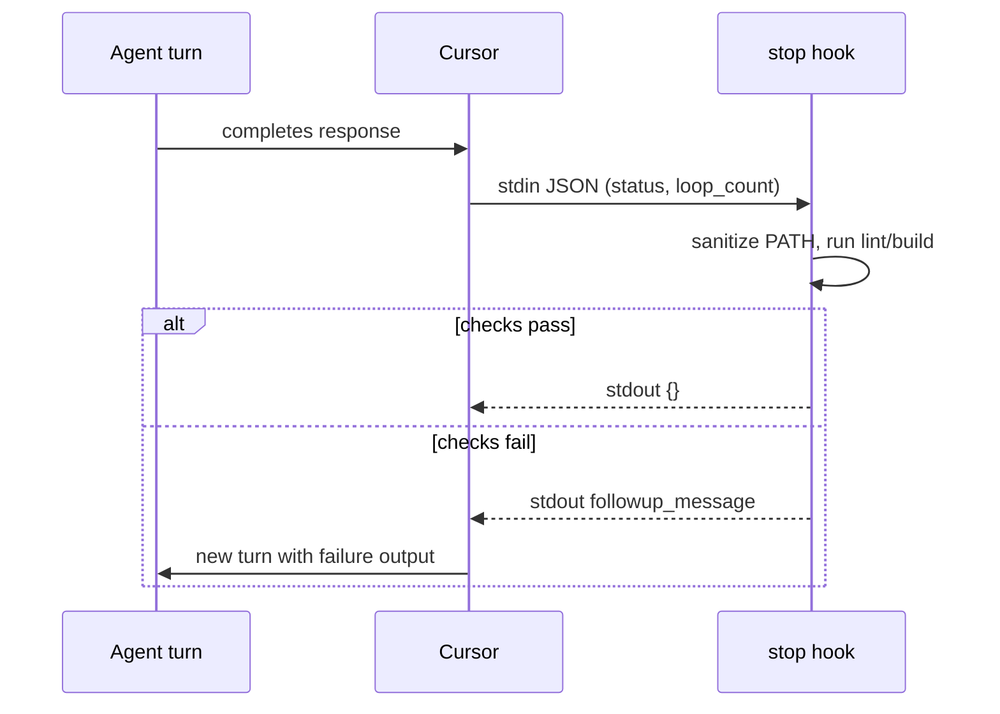

When an AI coding agent finishes a turn, the diff often looks ready long before lint, typecheck, and bundlers agree. Pasting failures back into the chat works, but it is manual, easy to skip under pressure, and it does not scale across a team. [Cursor agent hooks](https://cursor.com/docs/agent/hooks) attach scripts to lifecycle events so verification can run in the same context as the agent, and when you pick the right event—results can flow straight back into the next turn without you acting as a human relay.

This article is a practical explainer for experienced JavaScript and Node.js engineers who already use pnpm (or npm) locally and in CI. It synthesizes a real `stop` hook pattern: run `pnpm lint` and `pnpm build` after each agent turn, capture failures safely into JSON, and return `{}` when there is nothing left for the model to do. Along the way it documents three edge cases that are easy to miss in documentation alone: Cursor’s bundled Node on `PATH`, the infinite loop that appears when you misuse `followup_message`, and why `sessionEnd` is the wrong hook if you want self-healing.

## On this page

- [Background and prior art](#background-and-prior-art)
- [How Cursor agent hooks work](#how-cursor-agent-hooks-work)
- [Hook events: comparison and mental model](#hook-events-comparison-and-mental-model)
- [Why `stop` enables a self-healing loop](#why-stop-enables-a-self-healing-loop)
- [Implementing a verification hook](#implementing-a-verification-hook)
- [Pitfalls we hit in production](#pitfalls-we-hit-in-production)
- [Debug logging and skipping work on abort](#debug-logging-and-skipping-work-on-abort)
- [Reference configuration](#reference-configuration)
- [Trade-offs and alternatives](#trade-offs-and-alternatives)
- [Applications and examples](#applications-and-examples)
- [Validation and measurement](#validation-and-measurement)
- [Security and performance considerations](#security-and-performance-considerations)
- [Limitations and future work](#limitations-and-future-work)
- [Troubleshooting](#troubleshooting)
- [FAQ](#faq)
- [Next steps](#next-steps)

## Background and prior art

Teams have long separated "fast feedback in the editor" from "authoritative verification in CI." Format-on-save, ESLint integrations, and TypeScript language services shorten the inner loop. GitHub Actions (and similar hosted runners) enforce the outer loop on every pull request: install, lint, test, build, sometimes scan. That split is healthy. The gap appears when a coding agent produces a large diff quickly: local editor diagnostics may lag, and CI feedback arrives only after push—unless you wire something in between.

Cursor’s hooks sit in that middle space. They are not a replacement for GitHub Actions; they are an orchestration surface tied to the agent lifecycle. Prior art includes git hooks (pre-commit, pre-push), task runners, and IDE macros—but those either fire on version control events or on manual triggers, not automatically at the boundary between agent turns. Hooks are closer to "serverless functions for the IDE": stdin JSON in, stdout JSON out, with explicit contracts documented in [Agent Hooks](https://cursor.com/docs/agent/hooks).

The scenario this article optimizes for is a repo where `pnpm lint` and `pnpm build` are already the local definition of "green," and you want the agent to see the same failures your CI would surface—without you copying logs from a terminal panel.

## How Cursor agent hooks work

Hooks are commands Cursor runs at defined lifecycle points. The integration protocol is intentionally small: **stdin** carries a JSON payload from Cursor; **stdout** carries a JSON response your command prints; **stderr** is for human-oriented logs in the Hooks output channel. Cursor parses stdout as JSON when the process exits successfully.

You declare hooks in `hooks.json`:

- **Project hooks**: `.cursor/hooks.json` (committed, shared with the team)
- **User hooks**: `~/.cursor/hooks.json` (global, personal)

A minimal `stop` hook registration:

```json
{
  "version": 1,
  "hooks": {
    "stop": [
      {
        "command": ".cursor/hooks/my-hook.sh",
        "timeout": 120
      }
    ]
  }
}
```

The `command` path is relative to **the project root** for project hooks, or relative to **`~/.cursor/`** for user hooks. If you mix those rules, the hook can fail to run with no obvious in-editor error beyond an empty Hooks channel.

Cursor watches `hooks.json` and reloads on save. If changes do not apply, restart the editor.

### Command hook contract

For command-style hooks, keep the following in mind:

- **stdin**: JSON payload from Cursor
- **stdout**: JSON response (this is what Cursor parses)
- **stderr**: logs you want to read while diagnosing
- **Exit 0**: success; stdout JSON is honored
- **Exit 2**: block the action (equivalent to `"permission": "deny"` where applicable)
- **Other exit codes**: fail-open by default in many configurations—treat non-zero as "hook crashed," not "lint failed"

For a `stop` hook, the meaningful stdout shapes are `{}` (no further automation) or `{"followup_message": "..."}` (ask Cursor to enqueue another user message for the agent). That second path is what makes verification feedback feel like part of the conversation instead of a side channel.

## Hook events: comparison and mental model

Cursor exposes multiple hook events. The ones that matter most for "run checks after the agent does work" are summarized below.

| Event | When it fires | Agent-visible feedback |
| --- | --- | --- |
| `sessionEnd` | Composer chat **window closes** | Fire-and-forget; response is logged, not injected into a live loop |
| `stop` | Each **agent turn** completes | Yes — `followup_message` becomes the next user message |
| `postToolUse` | After a **single tool call** succeeds | Yes — `additional_context` is injected after the tool result |
| `afterFileEdit` | After the agent **edits a file** | No structured output fields at time of writing |

### First attempt: `sessionEnd`

`sessionEnd` sounds like "when everything is done, verify." It does run at a sensible boundary if you want auditing or telemetry. The problem is semantic: **the session is already ending.** If `pnpm lint` fails, there is no agent turn left to consume a structured response. You might still log to a file or push metrics, but you should not expect the model to self-correct from that signal.

### Better fit: `stop`

The `stop` hook fires when **each agent turn ends**—not when the chat closes, but after each model response completes. It supports `followup_message`, which Cursor can auto-submit as the next user message, which starts another agent turn. That closes the loop: agent writes code, hook runs checks, hook returns failures as a user-visible message, agent repairs, hook runs again, eventually stdout is `{}` and the conversation can stop without you retyping CI output.

Typical stdin for `stop` looks like:

```json
{
  "status": "completed",
  "loop_count": 0
}
```

`status` is one of `"completed"`, `"aborted"`, or `"error"`. `loop_count` counts how many times this hook has already triggered a follow-up in the conversation (starting at 0). That field matters when you reason about budgets and safety caps.

## Why `stop` enables a self-healing loop

The sequence is easier to reason about as a flow than as a bullet list. Conceptually:



The invariant you want is: **only emit `followup_message` when the model should take a corrective action.** If checks pass, return `{}` so the automation does not manufacture new user messages. The pitfall section below covers what happens when you violate that rule.

## Implementing a verification hook

The implementation pattern that has been reliable in bash is: read stdin once, optionally parse fields, sanitize the environment, run commands while capturing output, then print exactly one JSON object to stdout before exiting zero—even when lint fails (because the hook itself succeeded at reporting lint failure).

### Skeleton

```bash
#!/bin/bash
set -euo pipefail

json_input=$(cat)

# ... sanitize PATH, parse status, run checks ...

printf '%s\n' '{}'
exit 0
```

### Capturing output and returning `followup_message`

When `pnpm lint` or `pnpm build` fails, you need the agent to see stderr/stdout, but stdout must remain valid JSON. A practical approach is to capture command output to a variable or temp file, truncate to a safe size for context windows, and assemble JSON with a small Python helper (arbitrary shell output makes hand-rolled quoting fragile).

```bash
fail_with_followup() {
  local step_human=$1
  local exit_code=$2
  local raw_output=$3
  printf '%s' "$raw_output" | head -c 12000 | python3 -c '
import json, sys
step, code = sys.argv[1], int(sys.argv[2])
out = sys.stdin.read()
msg = (
    "The **stop** hook in this repo ran an automated check "
    "after your last agent turn (same commands as local CI).\n\n"
    f"**Command:** `{step}`\n"
    f"**Result:** failed with exit code **{code}**.\n\n"
    "Please fix the issues in the output below, then continue.\n\n"
    "```text\n" + out + "\n```\n"
)
print(json.dumps({"followup_message": msg}, ensure_ascii=False))
' "$step_human" "$exit_code"
  exit 0
}
```

Using `python3` here is deliberate: one stray `"` in tool output should not break the entire hook payload.

### Optional JSON parsing with `set -e`

If `jq` is missing or returns non-zero under `set -e`, the whole hook can exit before checks run. A common pattern is to default fields, then parse inside a temporary `set +e` block:

```bash
status="completed"
loop_count=0
if command -v jq >/dev/null 2>&1; then
  set +e
  status=$(printf '%s' "$json_input" | jq -r '.status // "completed"' 2>/dev/null)
  loop_count=$(printf '%s' "$json_input" | jq -r '.loop_count // 0' 2>/dev/null)
  set -e
fi
```

## Pitfalls we hit in production

### Pitfall 1: Cursor’s bundled Node on `PATH`

Symptom: `pnpm lint` fails inside the hook with `Error [ERR_REQUIRE_ESM]: require() of ES Module ...`, while the same command in your interactive terminal passes.

Cause: Cursor spawns hook processes with **its own bundled Node** early on `PATH` (commonly under `~/.cursor-server/bin/`). That Node version may be older than the toolchain your repository assumes, which breaks packages that moved to ESM-only loading paths.

Mitigation: strip Cursor’s runtime directories from `PATH` before invoking pnpm, or pin `NODE` explicitly in the `hooks.json` command string. One portable sanitizer uses `python3` to rebuild `PATH`:

```bash
sanitize_cursor_bundled_runtimes_from_path() {
  if command -v python3 >/dev/null 2>&1; then
    PATH="$(
      python3 -c '
import os
skip = (".cursor-server", ".vscode-server")
p = os.environ.get("PATH", "")
print(":".join(x for x in p.split(":")
               if x and not any(s in x for s in skip)))
'
    )"
    export PATH
    return 0
  fi
  # If python3 is unavailable, implement a PATH walk in bash for your environment.
}
```

After sanitization, `node` should resolve to the same binary you expect from nvm, fnm, mise, or your devcontainer feature—**not** the editor’s bundled runtime.

You can also pin a Node binary per hook:

```json
"command": "POST_SESSION_VERIFY_NODE=/usr/local/bin/node .cursor/hooks/post-session-verify.sh"
```

**Key takeaway:** hooks do not run inside your login shell. They inherit Cursor’s process environment, which may reorder `PATH` relative to an interactive session. Baseline this with logging (`which node`, `node -v`) while iterating.

### Pitfall 2: `followup_message` on success creates a loop

Symptom: the agent keeps responding forever; each turn re-triggers the hook; Hooks channel fills with repetitive success chatter.

Cause: returning `{"followup_message": "All checks passed!"}` after a green run still schedules another user message, which starts another agent turn, which hits `stop` again.

Mitigation: **use `followup_message` only when the model must change the repo.** On success, print `{}`. If you want operators to see success, log to stderr or rotate a log file—not stdout, and not `followup_message`.

Cursor also exposes `loop_limit` per hook script as a safety valve. Defaults are conservative, but you should still treat "success follow-ups" as a logic bug, not something to rely on the cap to mask.

### Pitfall 3: stdout is sacred

Symptom: Cursor ignores hook output; follow-ups never appear.

Cause: debug `echo` statements printing to stdout corrupt the JSON channel.

Mitigation: route diagnostics to stderr or a file. stdout should contain a single JSON object and nothing else.

### Pitfall 4: non-zero exit when returning JSON

Symptom: hook tries to return `followup_message`, but Cursor treats the hook as crashed.

Cause: exiting non-zero signals hook failure, not "lint failed."

Mitigation: on lint failure where you successfully composed JSON, **exit 0** so Cursor parses stdout. Reserve non-zero exits for true hook errors (missing script, unhandled bash `-e` failure before JSON emission).

## Debug logging and skipping work on abort

When the user cancels generation, `stop` may still run with `"status": "aborted"`. Running a full lint and build cycle there is usually wasted work and noisy. A small guard keeps the hook polite:

```bash
if [[ "${status}" == "aborted" ]]; then
  debug_log "stop hook: status=aborted — skipping pnpm lint/build"
  printf '%s\n' '{}'
  exit 0
fi
```

For `"error"` statuses, decide whether you want verification to run on top of a model-side failure; many teams skip or downgrade checks to avoid compounding confusion.

A `POST_SESSION_VERIFY_DEBUG`-style environment toggle is useful: when enabled, write timestamps, `which node`, and truncated command logs to a file; when disabled, keep stderr concise. That toggle can be set in `hooks.json` without editing the script body.

## Reference configuration

### `.cursor/hooks.json`

```json
{
  "version": 1,
  "hooks": {
    "stop": [
      {
        "command": ".cursor/hooks/post-session-verify.sh",
        "timeout": 600,
        "loop_limit": 10
      }
    ]
  }
}
```

`timeout` should reflect real project cost: cold caches and large TypeScript graphs can push lint and build into many minutes. `loop_limit` caps automatic follow-ups if logic regresses.

### `.cursor/hooks/post-session-verify.sh`

The script should:

1. Read stdin JSON (`status`, `loop_count`)
2. Sanitize `PATH` to remove Cursor’s bundled Node when needed
3. Optionally log tool versions when debug is enabled
4. Run `pnpm lint` then `pnpm build` sequentially (or your equivalents)
5. On failure: emit `followup_message` with command, exit code, and truncated output
6. On success: emit `{}`
7. On `aborted`: skip checks

Make it executable: `chmod +x .cursor/hooks/post-session-verify.sh`

## Trade-offs and alternatives

Hooks are powerful, but they are not uniformly the best control point.

| Approach | Strength | Cost or risk |
| --- | --- | --- |
| `stop` + `followup_message` | Strong self-heal loop; failures resemble user input | Full checks every turn can be slow; requires careful loop hygiene |
| `postToolUse` (Write matcher) | Finer granularity; less redundant work | More invocations; different response fields (`additional_context`) |
| `sessionEnd` | Good for audit, analytics, signing, cleanup | No live agent loop; not a substitute for in-turn repair |
| GitHub Actions only | Authoritative, reproducible, multi-OS matrices | Feedback arrives later; no automatic in-editor repair |
| Local git hooks | Enforced at commit time | Does not understand agent turns; can frustrate rapid WIP commits |

The key trade-off is **latency versus coverage**. `stop` optimizes for coverage at the turn boundary. `postToolUse` optimizes for tighter coupling to file mutations. CI optimizes for team-wide enforcement. In practice, combine them: hooks for fast local alignment, Actions for policy and release gates.

## Applications and examples

Beyond lint and build, the same pattern applies to:

- **Typecheck-only gates** for repositories where ESLint is noisy but `tsc --noEmit` is authoritative
- **Generated code drift checks** (`pnpm codegen && git diff --exit-code`) when agents edit protobuf or OpenAPI clients
- **Focused test slices** (`pnpm test --filter package-name`) when the agent is scoped to a package

Keep messages actionable: include the failing command, exit code, and enough log context to locate files without dumping entire build artifacts.

## Validation and measurement

To validate the hook environment matches your expectations, run these **from the same machine** but first in an interactive shell, then temporarily at the top of the hook (guarded by debug):

```bash
command -v node && node -v
command -v pnpm && pnpm -v
printf '%s\n' "$PATH" | tr ':' '\n' | head -n 40
```

**Quick check:** after adding PATH sanitization, confirm `which node` no longer points under `.cursor-server` when the hook prints its baseline log.

To validate JSON integrity without involving Cursor, pipe a synthetic payload:

```bash
printf '%s\n' '{"status":"completed","loop_count":0}' | .cursor/hooks/post-session-verify.sh
```

You should see exactly one JSON object on stdout. If you wrap the hook for testing, preserve stdin semantics.

## Security and performance considerations

**Security:** project hooks are code execution for everyone who opens the repository. Treat `.cursor/hooks/` like `.github/workflows/` or `package.json` scripts: review changes, pin dependencies, and avoid fetching remote shell snippets at runtime. If a hook reads secrets from the environment, remember they are available to the subprocess—same as any local script.

**Performance:** running full `pnpm build` after every turn can dominate wall time on large apps. Mitigations include caching, splitting "fast lint" from "slow build," using `postToolUse` for incremental checks, or scoping worksets when the agent is confined to a package. Always set `timeout` and `loop_limit` so a pathological loop cannot burn unlimited CPU.

## Limitations and future work

1. **Hooks are editor-local.** They do not absolve you of CI; they reduce surprise before push.
2. **Behavior evolves with Cursor versions.** stdin fields and supported events can expand; pin documentation dates in internal runbooks when you rely on subtle semantics.
3. **Non-deterministic agents:** even perfect logs do not guarantee the next turn fixes the root cause—budget follow-ups and keep human review on risky areas.

## Troubleshooting

| Symptom | Likely cause | Mitigation |
| --- | --- | --- |
| Hook never runs | Wrong `command` path for project vs user hooks | Use `.cursor/hooks/...` under repo root; restart Cursor |
| `ERR_REQUIRE_ESM` only in hook | Bundled Node on `PATH` | Sanitize `PATH` or set explicit `NODE` |
| Infinite agent chatter | Success `followup_message` | Return `{}` on green runs |
| stdout JSON ignored | Non-zero exit or stray prints | Exit 0 when emitting JSON; log to stderr |
| Slow sessions | Full build each turn | Narrow checks, use `postToolUse`, or cache |

## FAQ

**Q:** Should `stop` replace GitHub Actions?

**A:** No. Actions remain the team-wide source of truth for merges and releases. Hooks accelerate local agent loops; they do not provide isolated runners, required reviews, or branch protection by themselves. Keep parity by running the same pnpm scripts in both places.

**Q:** Why does `pnpm` work in my terminal but fail in the hook?

**A:** Different `PATH`, different Node, and missing login-shell init are the usual causes. Compare `which node` and `node -v` from a debug-enabled hook run against your interactive shell. Sanitize editor-bundled runtimes when versions diverge.

**Q:** Can I use npm instead of pnpm?

**A:** Yes. Replace commands with `npm run lint` / `npm run build` (or `npx`) as long as the hook’s environment resolves the same toolchain your CI uses. The integration pattern does not depend on pnpm specifically—pnpm appears here because that is what the reference repository used.

**Q:** How do I stop burning follow-ups on unfixable errors?

**A:** Lower `loop_limit`, improve the failure message with file anchors, and consider skipping heavy checks when `loop_count` exceeds a threshold you define inside the script (document that policy for your team).

**Q:** Is `postToolUse` safer than `stop` for large repos?

**A:** Often, yes, if your goal is to nudge after each write without paying a full build each turn. The trade-off is more hook invocations and different response semantics—consult the latest Agent Hooks documentation for field names and matchers.

## Next steps

If you are maintaining a Node.js monorepo with pnpm, a practical adoption path is:

1. Add `.cursor/hooks.json` with a conservative `timeout` and explicit `loop_limit`.
2. Implement `post-session-verify.sh` with PATH sanitization, abort skipping, and JSON-safe failure reporting.
3. Mirror the same scripts in GitHub Actions so "green locally" and "green in CI" mean the same thing.
4. Enable debug logging for one session, capture `node` resolution and PATH head, then turn debug off for day-to-day use.

Follow on X/Twitter ([@liran_tal](https://twitter.com/liran_tal)) for updates and shorter notes on developer tooling. Explore related examples and security-focused Node.js material on [GitHub](https://github.com/lirantal).