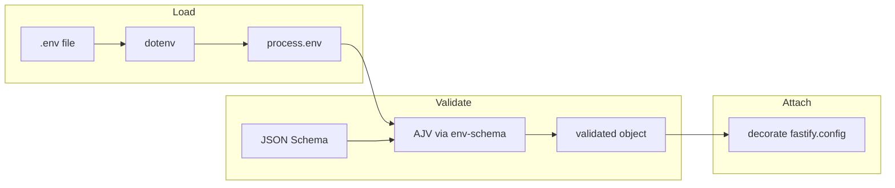

Node.js services pull config from all over: shell exports, whatever the orchestrator injects, secret stores, and local `.env` files so developers do not have to export fifty variables by hand. You still get the usual footguns: a typo in `process.env`, a missing key that only blows up halfway through a request, or a string sitting where you thought you had a number.

Here is one way to tighten that up on Fastify: `@fastify/env` (built on env-schema and dotenv) loads once, validates against a schema you wrote down, and hangs the result off the instance as `fastify.config`.

## Table of contents

- [Background and prior art](#background-and-prior-art)
- [How it works](#how-it-works-mechanism)
- [Source of truth for this tutorial](#source-of-truth-for-this-tutorial)
- [Step-by-step](#step-by-step)
- [Trade-offs and alternatives](#trade-offs-and-alternatives)
- [Applications and examples](#applications-and-examples)
- [Validation and measurement](#validation-and-measurement)
- [Troubleshooting](#troubleshooting)
- [Security and performance considerations](#security-and-performance-considerations)
- [Limitations and future work](#limitations-and-future-work)
- [FAQ](#faq)

## Background and prior art

Twelve-factor style apps treat the environment as the main config surface in production; `.env` files are the usual way to fake that surface locally without checking secrets into git. The `dotenv` package reads a file into `process.env`. That fixes loading, not correctness: every call site still has to agree on names, types, and defaults.

JSON Schema fills the gap: allowed keys, required fields, types. In Node, env-schema validates a plain object (often `process.env`) with AJV. `@fastify/env` wraps that as a Fastify plugin: optional dotenv load, validate, then decorate the server with something stable (here, `config`).

You could hand-roll this, use convict, Zod plus a small adapter, envalid, or a platform loader. The PR's stack is a good fit if you are already on Fastify, want a thin dependency story, and like AJV-style defaults and coercion.

Once a service has a pile of env vars (database URLs, buckets, feature flags, vendor keys), the cost of an undocumented name goes up fast. Someone pages you because the port is `undefined` or a flag is a string when the code expected a number. A schema does not replace docs, but it does give you a check that runs at boot: the process either satisfies the contract or exits before it takes traffic. Same image, different injected env across staging and prod, still one schema.

If you ship Fastify APIs, maintain internal templates, or review config and want `removeAdditional: true` so only declared keys land on `fastify.config`, this pattern is aimed at you. Not on Fastify? Same validation idea; you wire the lifecycle and where the object lives yourself.

## How it works (mechanism)

The pipeline is boring on purpose: dotenv loads into `process.env`, that object is the input, AJV validates it against your schema, then the result is attached to Fastify so routes read `fastify.config` instead of sprinkling `process.env` everywhere.

The example passes `dotenv: true` so `@fastify/env` pulls in dotenv (usually `.env` next to the process cwd). `data: process.env` is what gets validated. With `removeAdditional: true`, keys not in the schema are dropped on the decorated object, which doubles as an allowlist and makes mystery keys harder to smuggle into app code.

Do not skip `await fastify.ready()`. Plugin registration is async; `fastify.config` exists after the env plugin finishes. The sample `app.js` awaits `ready()` before returning the instance so `server.js` can read `app.config.HTTP_PORT` before `listen`.



Routes then use `server.config.DEBUG_LEVEL` so numbers and defaults match the schema, not whatever string happened to land in the OS environment.

In `app.js`, `envPlugin` registers before `indexRoutes`. Order barely matters in the toy repo; it matters when route registration pulls in code that touches `fastify.config` during setup. Habit worth keeping: env plugin near the top, schema in one file, and treat `process.env` as the edge (tests and the glue to the outside world), not the default read path.

If you grow into auth, rate limits, and persistence as separate plugins, they can all hang off `fastify.config` once env has run. When the graph gets hairy, `fastify-plugin` dependencies metadata is there to spell out the order.

## Source of truth for this tutorial

All file-level behavior described here was checked against the tree at:

- Pull request: [github.com/dotenv-org/examples/pull/13](https://github.com/dotenv-org/examples/pull/13)
- Commit: `0e292ec6036faaa6124f1c5d87609cecd07159f7`
- Directory: `usage/dotenv-fastify-envschema/`

Before you copy from the README alone: it tells you `cp .env-sample .env`, but that commit has no `.env-sample`. It shows `npm run start` while `package.json` has no `start` script (Docker scripts and a placeholder `test` only). A README snippet mentions `PORT` in the schema; the real plugin uses `HTTP_PORT` and `HTTP_HOST`. When in doubt, trust the JS (`plugins/env.js`, `app.js`, `server.js`, `routes/index.js`).

## Step-by-step

These steps mirror the PR's app path; start from an empty directory if you like.

Mirror the upstream layout so imports work without path aliases:

```text
your-project/
  package.json
  package-lock.json   # optional but recommended after first npm install
  server.js           # process entry
  app.js              # builds Fastify + plugins
  plugins/
    env.js
  routes/
    index.js
  .env                # local only; never commit secrets
```

### Step 1: Initialize the package and dependencies

Create `package.json` with ES modules and the same direct dependencies as the reference example:

```json
{
  "name": "fastify-dotenv-envschema-example",
  "version": "1.0.0",
  "type": "module",
  "main": "server.js",
  "scripts": {
    "start": "node server.js"
  },
  "dependencies": {
    "@fastify/env": "^4.2.0",
    "fastify": "^4.10.2",
    "fastify-plugin": "^4.4.0"
  }
}
```

I added a `start` script because the upstream README mentions `npm run start` but the PR never defined it; `node server.js` does the same thing.

Run `npm install`. The PR's lockfile pins transitives (dotenv and env-schema come in via `@fastify/env`); in CI or prod, use `npm ci` when you have a lockfile.

Sanity check from the project root: `node -e "import('@fastify/env').then(() => console.log('ok'))"` should print `ok`.

### Step 2: Add the environment plugin (`plugins/env.js`)

Add `plugins/env.js` with the schema and `@fastify/env` options. The reference requires `HTTP_PORT` and `HTTP_HOST`; `DEBUG_LEVEL` is optional but gets a default.

```javascript
import fastifyEnv from "@fastify/env";
import fastifyPlugin from "fastify-plugin";

async function configPlugin(server, options, done) {
  const schema = {
    type: "object",
    required: ["HTTP_PORT", "HTTP_HOST"],
    properties: {
      HTTP_PORT: {
        type: "number",
        default: 3000,
      },
      HTTP_HOST: {
        type: "string",
        default: "0.0.0.0",
      },
      DEBUG_LEVEL: {
        type: "number",
        default: 1000,
      },
    },
  };

  const configOptions = {
    confKey: "config",
    schema: schema,
    data: process.env,
    dotenv: true,
    removeAdditional: true,
  };

  return fastifyEnv(server, configOptions, done);
}

export default fastifyPlugin(configPlugin);
```

The PR wraps the plugin with `fastify-plugin` so encapsulation matches the rest of your plugin graph.

### Step 3: Build the Fastify instance (`app.js`)

`app.js` registers env, registers routes, then awaits readiness:

```javascript
import Fastify from "fastify";

import indexRoutes from "./routes/index.js";
import envPlugin from "./plugins/env.js";

export default async function appFramework() {
  const fastify = Fastify({ logger: true });
  fastify.register(envPlugin);
  fastify.register(indexRoutes);

  await fastify.ready();

  return fastify;
}
```

Without `await fastify.ready()`, anything that reads `fastify.config` right away can race plugin init.

### Step 4: Add a route that reads config (`routes/index.js`)

`routes/index.js`:

```javascript
import fastifyPlugin from "fastify-plugin";

async function indexRoutes(server, options) {
  server.get("/", async (request, reply) => {
    return {
      hello: "hello world",
      debugLevel: server.config.DEBUG_LEVEL,
    };
  });
}

export default fastifyPlugin(indexRoutes);
```

That shows `DEBUG_LEVEL` as a number on `server.config`, not only the string form in `process.env`.

### Step 5: Entry point and listener (`server.js`)

`server.js`:

```javascript
import appFramework from "./app.js";

async function initAppServer() {
  const app = await appFramework();

  try {
    await app.listen({
      port: app.config.HTTP_PORT,
      host: app.config.HTTP_HOST,
    });
  } catch (err) {
    app.log.error(err);
    process.exit(1);
  }
}

initAppServer();
```

The OS still hands you strings; AJV coercion is what makes `HTTP_PORT` and `DEBUG_LEVEL` numbers on `fastify.config` while `.env` lines stay plain `HTTP_PORT=3000`.

### Step 6: Create a local `.env` file

There is no `.env-sample` in that commit, so add `.env` next to `server.js` yourself. Example:

```bash
HTTP_PORT=3000
HTTP_HOST=127.0.0.1
DEBUG_LEVEL=42
```

Keep `.env` out of git (upstream already ignores it). For a team, ship a committed `.env.example` or a short table in the readme so onboarding is not guesswork.

## Trade-offs and alternatives

Main fork in the road: where validation runs and what surface app code sees.

| Approach | Pros | Cons |
| --- | --- | --- |
| Raw `process.env` reads | No dependencies; trivial to start | No schema, no coercion, typos fail late |
| `dotenv` only | Simple local dev story | Still no validation or centralized defaults |
| **env-schema** standalone | Validates any object; framework-agnostic | You wire decoration and lifecycle yourself |
| **`@fastify/env` (this article)** | Integrated with Fastify; dotenv option; decoration | Coupled to Fastify; AJV schema dialect |
| **Zod** / **TypeScript** schemas | Rich type inference if you invest in TS pipeline | Extra tooling; not the default in the PR example |

If several processes or libs each call dotenv, a single `import "dotenv/config"` at the top of the entry file can be clearer than hiding load inside the plugin. The PR uses `@fastify/env` with `dotenv: true`, which is fine for one Fastify process.

Pick a row based on who owns lifecycle, not on who wins a "best package" thread online. If you already lean on Zod for HTTP payloads, using it for env too saves a context switch. If Fastify plus AJV is already the house style, `@fastify/env` matches how routes and serializers behave. Tiny scripts with two env vars can live on raw `process.env` until something proves otherwise.

## Applications and examples

Same idea for CORS origins, feature toggles, database URLs: name them in the schema, decide what is required in prod, read `fastify.config` from handlers or services.

Tests: set env before you build the app, or pass a custom `data` object if you teach the plugin to accept options (the PR reads `process.env` directly). Point is to hit the same schema production uses.

Monorepo with an API and a tiny CLI: export the schema (or a small builder) from one module so the CLI and server do not drift. The PR inlines the schema for readability; some teams lift it to something like `config/schema.mjs` and import both places.

After boot, logging a redacted slice of non-secret config (ports, hosts, log levels) at info is useful. Do not log connection strings. `DEBUG_LEVEL` here is really "whatever knob you hand the logger or debug middleware."

## Validation and measurement

Quick smoke test once the files are in place:

1. Start the server (from the project root):

   ```bash
   node server.js
   ```

2. In another terminal, request the index route:

   ```bash
   curl -sS http://127.0.0.1:3000/
   ```

You want JSON like:

```json
{"hello":"hello world","debugLevel":42}
```

with `DEBUG_LEVEL=42` in `.env`. Pino may still chatter on the terminal depending on how you run `curl`; the body is what matters.

Break it on purpose: set `HTTP_PORT=not-a-number`, leave the rest valid, restart. AJV should fail `type: "number"` during plugin init and the process should exit before `listen`. That tells you validation is on the critical path, not after the fact.

`npm ls @fastify/env fastify` is a quick version check against the tree you actually installed.

The PR ships a multi-stage `Dockerfile` running `node server.js` under `dumb-init`. If you go that route, inject config with `docker run -e` or your orchestrator, not by baking `.env` into the image. I am not going through build flags here; the folder under `usage/dotenv-fastify-envschema` is enough to crib from.

## Troubleshooting

| Symptom | Likely cause | Fix |
| --- | --- | --- |
| `fastify.config` is undefined right after `register` | Readiness race | `await fastify.ready()` before using `config`, as in `app.js`. |
| Server starts but values ignore `.env` | Wrong working directory or dotenv disabled | Run `node server.js` from the directory that contains `.env`, or set `dotenv: true` and verify paths. |
| Validation errors on numeric fields | Unquoted values treated as strings without coercion | Schema types must match what AJV expects; lines like `HTTP_PORT=3000` stay numeric without quotes. |

## Security and performance considerations

`.env` is handy locally and awful in git. Committed samples should be non-secret. In production, inject secrets through the platform, and let the schema describe shape, not literal secret values. For a longer take on env-as-secrets, see [Do not use secrets in environment variables and here's how to do it better](https://www.nodejs-security.com/blog/do-not-use-secrets-in-environment-variables-and-here-is-how-to-do-it-better).

Startup validation is cheap next to network I/O and saves a lot of "why is prod different?" incidents.

The env plugin runs at startup, not per request, so runtime cost is noise next to your handlers.

Pin deps with a lockfile and run `snyk test` (or your scanner) on a cadence you can live with. Transitives will flag sometimes; bump them like any other maintenance, not as an excuse to drop validation.

## Limitations and future work

The PR targets Fastify 4.x and `@fastify/env` 4.x. Major bumps can change options or schema behavior; read release notes before you slide versions.

Missing `.env-sample` and a `start` script in upstream are small papercuts; fixing them would match what the readme already claims.

Bigger orgs sometimes split public config from secret material, or share one typed module built on the same schema between CLI and server.

`DEBUG_LEVEL` here is a toy. Production setups often use enums or bounded ints for verbosity once ops agrees on the allowed set.

Env key names rarely care about i18n or Windows paths, but editors that slap a BOM on `.env` can make a key look right and still not match; `xxd .env | head` is the rude but honest debug move.

## FAQ

**Why `await fastify.ready()` in `app.js`?** Async plugins may not have finished decorating the instance yet. `ready()` waits for that pipeline so `fastify.config` exists before `server.js` reads host and port.

**TypeScript instead of JavaScript?** Same layout works with sane `tsconfig` module settings. Small wrappers around `config` or types generated from the schema are both common.

**What if I load dotenv before Fastify starts?** Then `process.env` is already filled when `@fastify/env` validates `data`. Watch for double loads or two different opinions about which `.env` path counts; pick one owner for dotenv in the repo.

**Does `removeAdditional: true` strip keys from `process.env`?** The plugin builds the decorated object; do not assume it sanitizes the global env for security. Treat `fastify.config` as the supported read surface.