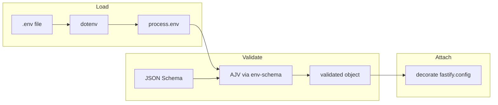

Node.js services read configuration from many places: shell exports, orchestrator-injected variables, platform secret stores, and local `.env` files for developer ergonomics. The failure mode is familiar: a typo in `process.env`, a missing variable discovered only at runtime deep inside a request handler, or a silent string where the code expected a number.

This article shows how to centralize that story for **Fastify** using **`@fastify/env`**, which builds on **env-schema** and **dotenv**, so configuration is loaded once, validated against an explicit schema, and attached to the application as **`fastify.config`**. 

## Table of contents

- [Background and prior art](#background-and-prior-art)
- [How it works](#how-it-works-mechanism)
- [Source of truth for this tutorial](#source-of-truth-for-this-tutorial)
- [Step-by-step: build the example](#step-by-step-build-the-example)
- [Trade-offs and alternatives](#trade-offs-and-alternatives)
- [Applications and examples](#applications-and-examples)
- [Validation and measurement](#validation-and-measurement)
- [Security and performance considerations](#security-and-performance-considerations)
- [Limitations and future work](#limitations-and-future-work)
- [Troubleshooting](#troubleshooting)
- [FAQ](#faq)
- [Next steps](#next-steps-and-call-to-action)
- [References](#references)

## Background and prior art

At a high level, twelve-factor style applications treat the environment as the canonical configuration surface in production, while `.env` files are a convenient way to reproduce that surface locally without committing secrets. The **`dotenv`** package reads a file and populates **`process.env`**. That solves loading, but not correctness: every access site must agree on names, types, and defaults.

**JSON Schema** validation closes that gap by describing allowed keys, required fields, and types. The Fastify ecosystem packages that idea for Node through **env-schema** (AJV-backed validation of a plain object, often `process.env`) and **`@fastify/env`**, which registers as a Fastify plugin, optionally loads dotenv, validates, and **decorates** the server instance with a stable accessor (here, **`config`**).

Prior art includes hand-rolled validation, standalone libraries (for example **convict**, **Zod** with a custom env adapter, or **envalid**), and platform-specific config loaders. The PR’s approach is attractive when you already use Fastify and want a small dependency footprint with schema-driven defaults and coercion aligned to **AJV** conventions.

Why now, for typical teams? As services accumulate environment variables—database URLs, object store endpoints, feature flags, and third-party API keys—the marginal cost of an undocumented variable rises. On-call engineers lose time tracing `undefined` ports or mis-typed feature flags. Schema-first configuration does not replace good documentation, but it gives you a machine-checked contract that boots succeed only when that contract is satisfied. That is especially valuable in continuous deployment pipelines where the same container image must run across staging and production with different injected environments.

Who benefits most? Backend engineers shipping Fastify APIs, platform teams standardizing Node service templates, and security reviewers who want an explicit allowlist of configuration keys (`removeAdditional: true`) so accidental leakage of unexpected `process.env` keys into application logic is less likely. If you are not on Fastify, the same validation primitives still apply; only the decoration step changes.

## How it works (mechanism)

In practice, the pipeline has four stages: **load** dotenv into `process.env`, **read** that object as the configuration source, **validate** it against a JSON Schema, and **decorate** the Fastify instance so handlers and sibling plugins read `fastify.config` instead of scattered `process.env` reads.

The example sets **`dotenv: true`** on the plugin options so **`@fastify/env`** triggers dotenv loading (typically `.env` in the project root). It sets **`data: process.env`** as the input object to validate. **`removeAdditional: true`** strips keys not declared in the schema, which turns the config object into an explicit allowlist and reduces the chance that unknown keys mask typos or leaked data.

**`fastify.ready()`** is easy to overlook but important in this pattern. Plugin registration is asynchronous; decoration of `fastify.config` completes when the env plugin has finished. The sample **`app.js`** awaits **`fastify.ready()`** before returning the instance so callers (for example **`server.js`**) can safely read **`app.config.HTTP_PORT`** before calling **`listen`**.



The route layer then reads **`server.config.DEBUG_LEVEL`** rather than indexing `process.env` directly, which keeps types and defaults consistent with the schema.

Plugin order in **`app.js`** registers **`envPlugin`** before **`indexRoutes`**. That ordering matters less for this tiny example than for real codebases where routes might import services that read `fastify.config` during registration. A useful discipline is to treat the env plugin as part of your **foundation**: register it early, keep its schema in one module, and avoid reading `process.env` directly outside tests or the narrow boundary where you intentionally bridge external systems.

If you later split the monolith into multiple plugins (auth, rate limiting, persistence), each plugin can depend on **`fastify.config`** as long as the env plugin completed first. Fastify’s dependency graph features (`fastify-plugin` metadata such as `dependencies`) can express that explicitly when the graph grows.

## Source of truth for this tutorial

All file-level behavior described here was checked against the tree at:

- Pull request: [github.com/dotenv-org/examples/pull/13](https://github.com/dotenv-org/examples/pull/13)
- Commit: `0e292ec6036faaa6124f1c5d87609cecd07159f7`
- Directory: `usage/dotenv-fastify-envschema/`

**Upstream inconsistencies worth knowing before you copy-paste.** The README in that commit instructs readers to run `cp .env-sample .env`, but **no `.env-sample` file exists** in the tree. The README also shows a `npm run start` command while **`package.json` defines no `start` script** (only Docker helpers and a placeholder `test`). Finally, a README snippet names a `PORT` field in the schema, whereas the actual plugin uses **`HTTP_PORT`** and **`HTTP_HOST`**. This tutorial follows the **JavaScript sources** (`plugins/env.js`, `app.js`, `server.js`, `routes/index.js`) as authoritative.

## Step-by-step

The following steps recreate the PR’s application code path. You can create a new empty directory for the project.

**Layout.** Mirror the upstream layout so imports resolve without path aliases:

```text
your-project/
  package.json
  package-lock.json   # optional but recommended after first npm install
  server.js           # process entry
  app.js              # builds Fastify + plugins
  plugins/
    env.js
  routes/
    index.js
  .env                # local only; never commit secrets
```

### Step 1 — Initialize the package and dependencies

Create **`package.json`** with ES modules enabled and the same direct dependencies as the reference example:

```json
{
  "name": "fastify-dotenv-envschema-example",
  "version": "1.0.0",
  "type": "module",
  "main": "server.js",
  "scripts": {
    "start": "node server.js"
  },
  "dependencies": {
    "@fastify/env": "^4.2.0",
    "fastify": "^4.10.2",
    "fastify-plugin": "^4.4.0"
  }
}
```

The **`start`** script above is a practical addition: the upstream README suggests `npm run start`, but the PR never added that script. Running **`node server.js`** is equivalent.

Install with **`npm install`**. The lockfile in the PR pins transitive versions (including **dotenv** and **env-schema** under **`@fastify/env`**); for reproducibility in production, prefer **`npm ci`** when a lockfile is present.

**Quick check:** `node -e "import('@fastify/env').then(() => console.log('ok'))"` should print `ok` from the project root after install.

### Step 2 — Add the environment plugin (`plugins/env.js`)

Create **`plugins/env.js`**. This module defines the JSON Schema and passes options to **`@fastify/env`**. Required keys in the reference are **`HTTP_PORT`** and **`HTTP_HOST`**; **`DEBUG_LEVEL`** is optional in the schema sense but has a default.

```javascript
import fastifyEnv from "@fastify/env";
import fastifyPlugin from "fastify-plugin";

async function configPlugin(server, options, done) {
  const schema = {
    type: "object",
    required: ["HTTP_PORT", "HTTP_HOST"],
    properties: {
      HTTP_PORT: {
        type: "number",
        default: 3000,
      },
      HTTP_HOST: {
        type: "string",
        default: "0.0.0.0",
      },
      DEBUG_LEVEL: {
        type: "number",
        default: 1000,
      },
    },
  };

  const configOptions = {
    confKey: "config",
    schema: schema,
    data: process.env,
    dotenv: true,
    removeAdditional: true,
  };

  return fastifyEnv(server, configOptions, done);
}

export default fastifyPlugin(configPlugin);
```

**Why `fastify-plugin`?** Wrapping the plugin ensures Fastify treats it with the intended encapsulation semantics relative to your other plugins. The PR uses the same pattern.

### Step 3 — Build the Fastify instance (`app.js`)

Create **`app.js`** to register the env plugin and routes, then await readiness:

```javascript
import Fastify from "fastify";

import indexRoutes from "./routes/index.js";
import envPlugin from "./plugins/env.js";

export default async function appFramework() {
  const fastify = Fastify({ logger: true });
  fastify.register(envPlugin);
  fastify.register(indexRoutes);

  await fastify.ready();

  return fastify;
}
```

Without **`await fastify.ready()`**, code that immediately reads **`fastify.config`** can race plugin initialization.

### Step 4 — Add a route that reads config (`routes/index.js`)

Create **`routes/index.js`**:

```javascript
import fastifyPlugin from "fastify-plugin";

async function indexRoutes(server, options) {
  server.get("/", async (request, reply) => {
    return {
      hello: "hello world",
      debugLevel: server.config.DEBUG_LEVEL,
    };
  });
}

export default fastifyPlugin(indexRoutes);
```

This demonstrates that **`DEBUG_LEVEL`** is visible as a number on **`server.config`**, not only as a string in **`process.env`**.

### Step 5 — Entry point and listener (`server.js`)

Create **`server.js`**:

```javascript
import appFramework from "./app.js";

async function initAppServer() {
  const app = await appFramework();

  try {
    await app.listen({
      port: app.config.HTTP_PORT,
      host: app.config.HTTP_HOST,
    });
  } catch (err) {
    app.log.error(err);
    process.exit(1);
  }
}

initAppServer();
```

**Note on types from the environment.** Operating systems pass environment variables as strings. Schema-driven coercion (via AJV) is what lets **`HTTP_PORT`** and **`DEBUG_LEVEL`** behave as numbers in **`fastify.config`**. Your `.env` can still contain `HTTP_PORT=3000` on a single line.

### Step 6 — Create a local `.env` file

Because the repository does not ship **`.env-sample`**, create **`.env`** yourself at the project root next to **`server.js`**. Example:

```bash
HTTP_PORT=3000
HTTP_HOST=127.0.0.1
DEBUG_LEVEL=42
```

Keep **`.env`** out of version control (the upstream `.gitignore` already ignores it). For teams, maintain a committed **`.env.example`** or documented table of variables so onboarding stays repeatable.

## Trade-offs and alternatives

The key trade-off is **where** validation runs and **what** surface you expose to application code.

| Approach | Pros | Cons |
| --- | --- | --- |
| Raw `process.env` reads | No dependencies; trivial to start | No schema, no coercion, typos fail late |
| `dotenv` only | Simple local dev story | Still no validation or centralized defaults |
| **env-schema** standalone | Validates any object; framework-agnostic | You wire decoration and lifecycle yourself |
| **`@fastify/env` (this article)** | Integrated with Fastify; dotenv option; decoration | Coupled to Fastify; AJV schema dialect |
| **Zod** / **TypeScript** schemas | Rich type inference if you invest in TS pipeline | Extra tooling; not the default in the PR example |

In practice, if you run multiple processes or libraries that each call dotenv, you may want a single, explicit **`import "dotenv/config"`** at the very top of the entry file instead of relying on plugin-triggered loading. The PR defers that choice to **`@fastify/env`** with **`dotenv: true`**, which is appropriate for a single Fastify process.

Choosing among rows is less about “best package” and more about **lifecycle ownership**. If your team already standardizes on Zod for HTTP payloads, mirroring that for env can reduce cognitive load. If you optimize for Fastify-native patterns and AJV everywhere, **`@fastify/env`** stays consistent with how Fastify validates routes and serializers. If you operate minimal services with one or two variables, raw `process.env` might suffice until incidents prove otherwise.

## Applications and examples

**HTTP binding and feature flags.** The same pattern extends to CORS origins, feature toggles, or database URLs: declare them in the schema, mark which are required in production, and read **`fastify.config`** from route handlers or services.

**Testing.** For unit tests, set environment variables before building the app, or inject a custom **`data`** object if you refactor the plugin to accept options (the PR uses **`process.env`** directly). The important invariant is that tests exercise the same schema the process uses in production.

**Multi-service repositories.** In a repo that ships both a Fastify API and a small CLI, export the JSON Schema (or a builder function) from a shared module so the CLI and server cannot drift. The PR keeps the schema inline for clarity; production templates sometimes move it to **`config/schema.mjs`** and import it from both places.

**Observability.** After startup, log a redacted snapshot of non-secret config (ports, hosts, log levels) at info level. Never log raw connection strings. The **`DEBUG_LEVEL`** field in the example is a stand-in for “verbosity knobs” you might feed into loggers or diagnostic middleware.

## Validation and measurement

To validate this end to end after following the steps:

1. Start the server (from the project root):

   ```bash
   node server.js
   ```

2. In another terminal, request the index route:

   ```bash
   curl -sS http://127.0.0.1:3000/
   ```

**Expected output:** JSON similar to:

```json
{"hello":"hello world","debugLevel":42}
```

when **`DEBUG_LEVEL=42`** is set in `.env`. Log lines from Pino may appear on the console depending on how you run **`curl`** alongside the server; the response body should match the schema-backed values.

**Negative test:** set **`HTTP_PORT=not-a-number`** in `.env` (leave other keys valid) and restart. AJV should reject coercion to **`type: "number"`**, and the process should exit during plugin initialization rather than binding a listener. That confirms validation is on the critical path.

**Validate:** `npm ls @fastify/env fastify` confirms installed versions against your lockfile.

**Docker (optional).** The PR includes a multi-stage **`Dockerfile`** that runs **`node server.js`** under **`dumb-init`**. If you containerize, pass real configuration with **`docker run -e`** or orchestrator secrets, not by baking a `.env` into the image. The static example under `usage/dotenv-fastify-envschema` is a fine reference for layering, but this article does not walk through image build flags.

## Troubleshooting

| Symptom | Likely cause | Fix |
| --- | --- | --- |
| `fastify.config` is undefined right after `register` | Readiness race | **`await fastify.ready()`** before using `config`, as in **`app.js`**. |
| Server starts but values ignore `.env` | Wrong working directory or dotenv disabled | Run **`node server.js`** from the directory that contains `.env`, or set **`dotenv: true`** and verify paths. |
| Validation errors on numeric fields | Unquoted values treated as strings without coercion | Ensure schema types match what AJV expects; keep values numeric in `.env` lines like **`HTTP_PORT=3000`**. |

## Security and performance considerations

**Secrets versus configuration.** `.env` is convenient for local secrets but dangerous if committed. Treat repository copies as **non-secret** samples only. For production, prefer orchestrator or cloud secret injection into the environment, and keep schemas describing **shape**, not embedding secret values. **Read this:** [Do not use secrets in environment variables and here's how to do it better](https://www.nodejs-security.com/blog/do-not-use-secrets-in-environment-variables-and-here-is-how-to-do-it-better)

**Fail-fast behavior.** Validating at startup costs a fraction of a millisecond relative to network I/O but prevents entire classes of misconfiguration incidents. That is usually a favorable trade-off for API servers.

**Performance.** Validation runs when the env plugin executes during startup, not per request. Runtime overhead is therefore negligible compared to handler work.

**Supply chain.** Pin dependencies with a lockfile and run **`snyk test`** on a schedule. The reference **`npm ci`** output in a local smoke test may report vulnerabilities on transitive packages; treat upgrades like any other dependency maintenance, not as a dismissal of schema validation.

## Limitations and future work

The PR targets **Fastify 4.x** and **`@fastify/env` 4.x**. Major upgrades may change plugin options or schema handling; always read the release notes before bumping.

The missing **`.env-sample`** and **`start` script** in the upstream tree are paper cuts for newcomers; adding those files would align documentation with behavior.

For larger teams, consider splitting **public** configuration from **secret** material, or using a typed configuration module built on the same schema so CLI tools and servers share one definition.

The example’s **`DEBUG_LEVEL`** is illustrative. Real systems often map verbosity enums or structured logging fields; your schema can use **`enum`** or bounded integers once you agree on allowed values with operators.

Internationalization and Windows path quirks rarely affect env keys themselves, but watch for tools that rewrite `.env` with BOM prefixes; if a key mysteriously fails to match, inspect bytes with **`xxd .env | head`** in a terminal.

## FAQ

**Q: Why `await fastify.ready()` in `app.js`?**  
**A:** Decoration from asynchronous plugins is not guaranteed to exist until Fastify finishes loading plugins. `ready()` flushes that pipeline so `fastify.config` is populated before `server.js` reads ports and hosts.

**Q: Can I use TypeScript instead of JavaScript?**  
**A:** Yes. The same files compile cleanly with appropriate `tsconfig` module settings; you may wrap `config` access in small helpers for stronger typing, or generate types from the JSON Schema.

**Q: What if I load dotenv manually before Fastify starts?**  
**A:** That can work: variables will already be in `process.env` when `@fastify/env` validates `data`. The main risk is double-loading or conflicting path expectations; pick one clear ownership story for dotenv in your codebase.

**Q: Does `removeAdditional: true` delete keys from `process.env` itself?**  
**A:** The plugin validates and materializes the decorated config object; it does not rewrite the global `process.env` object in a way you should rely on for security isolation. Treat decoration output as the supported read API.