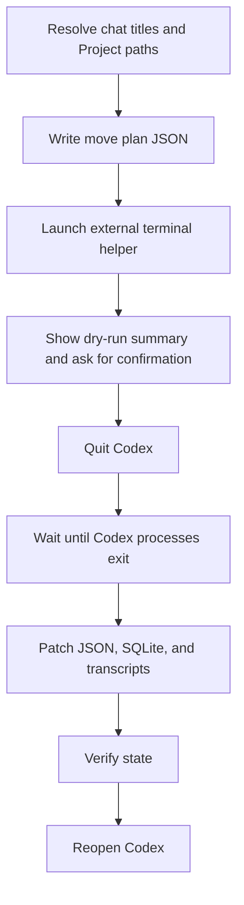

Agent workflows become fragile when they rely on a person to wait the right number of seconds. They become much more reliable when they coordinate with the process that owns the state.

That was the useful lesson from a small Codex workflow problem: moving existing chats into saved Projects. The initial instinct was to patch local state directly. The first attempt looked reasonable. The state files changed. The app restarted. Then the changes disappeared, because the running app still owned the state and flushed its older in-memory copy on quit.

The fix was not a longer sleep. The fix was changing the workflow boundary.

Instead of asking a human to close Codex, wait 20 seconds, and reopen it, the reusable workflow should launch a separate helper process. That helper waits until the [Codex app](https://developers.openai.com/codex/app) has fully exited, applies the migration while no Codex process owns the state, verifies the result, then reopens Codex. The important shift is from time-based instructions to state ownership.

## Background: When Agent Automation Touches Local App State

Codex is designed around Projects, threads, local environments, skills, approvals, and sandbox boundaries. The public model is useful: a Project gives Codex a folder to work in, and a thread carries context around that work. The [Codex skills documentation](https://developers.openai.com/codex/skills) describes skills as reusable workflows made of instructions, optional scripts, and supporting resources. That is exactly the right abstraction for a workflow that is too precise to keep rewriting by hand.

The rough edge appears when a useful workflow sits outside a supported UI operation. In this case, the desired operation was conceptually simple: take a list of existing chats and associate each one with a saved Project directory. The UI did not expose that as drag-and-drop or a move command.

Local state made the operation possible, but not automatically safe. The thread grouping depended on more than one source of truth:

- a global JSON state file for projectless thread IDs and workspace root hints
- a SQLite database row for each thread's current working directory and sandbox policy
- transcript JSONL metadata with the session cwd and environment context

Editing any one of those in isolation was not enough. Editing them while the app was running was worse, because the app could still write an older version after the edit. That is the pattern worth generalizing: if an app owns a state file, file mutation is not the unit of coordination. Process ownership is.

## The Mechanism: Split Planning From Mutation

The reusable design splits the workflow into two halves.

The first half runs inside Codex while the app is still alive. It resolves user intent into a move plan:

```json
{
  "version": 1,
  "codexHome": "~/.codex",
  "reopenCodex": true,
  "moves": [
    {
      "threadId": "thread-id-from-codex",
      "threadTitle": "Fix link checker CI",
      "targetProjectName": "GH",
      "targetCwd": "~/Documents/GH"
    }
  ]
}
```

This is the part an agent is good at: use available thread and project metadata, disambiguate titles, reject guesses, and produce a small declarative plan. It should not mutate app state yet.

The second half runs outside Codex in a terminal helper. That helper owns the lifecycle:



The terminal boundary matters. If the helper lived only inside the current Codex process, quitting Codex could interrupt the automation that was supposed to apply the fix. A detached terminal process survives the app quit and can complete the sequence.

In the implementation, the shell wrapper asks for a single explicit confirmation, then uses macOS automation to quit Codex:

```bash
osascript -e 'tell application "Codex" to quit'

while pgrep -f "$CODEX_PATTERN" >/dev/null 2>&1; do
  sleep 2
done

sleep "${CODEX_CHAT_ORGANIZER_WAIT_BUFFER_SECONDS:-5}"
node "$SCRIPT_DIR/apply-move-plan.mjs" --plan "$PLAN_PATH"
open -a Codex
```

The five-second sleep is not the core safety property. It is a flush buffer after the real condition has been met: the Codex Renderer, Service, and main app processes are gone. That distinction is the difference between a race and a protocol.

## What The Patcher Changes

The state patcher is a Node.js script because JSON and transcript rewriting are more maintainable with structured APIs than with ad hoc shell substitutions. It still uses the `sqlite3` command-line tool for the database update, because the [SQLite CLI](https://www.sqlite.org/cli.html) already provides stable backup and checkpoint operations without adding a package dependency.

At a high level, the patcher performs five operations:

1. Validate the move plan.
2. Back up every touched file.
3. Update the global JSON state.
4. Update SQLite thread rows.
5. Patch transcript metadata and verify the result.

The global JSON change removes moved threads from the projectless list and writes workspace hints:

```js
state["projectless-thread-ids"] =
  state["projectless-thread-ids"].filter((id) => !ids.has(id));

for (const move of moves) {
  state["thread-workspace-root-hints"][move.threadId] = move.targetCwd;
  delete state["thread-projectless-output-directories"][move.threadId];
}
```

The SQLite update changes the thread cwd and replaces the sandbox policy with a policy rooted in the target Project directory. That matters because a moved chat should not only appear under the right Project; future local commands should also inherit the right workspace permissions.

The transcript patch is intentionally narrower than a global search-and-replace. It updates session metadata, turn context payloads, and environment context messages. It does not rewrite arbitrary historical prose in the conversation. That boundary avoids turning a migration into a content editor.

The patcher uses [Node.js filesystem APIs](https://nodejs.org/api/fs.html) for reads, writes, backups, and recursive transcript discovery. Each write has a reason. Each write has a verification step.

## Trade-offs And Alternatives

There were several possible designs, and most of them look cleaner until you account for ownership and recovery.

| Approach | Benefit | Failure Mode | Verdict |
| --- | --- | --- | --- |
| Patch files while Codex is running | Fast, no app restart | The app can overwrite changes on quit | Rejected |
| Tell the user to wait 20 seconds | Easy to explain | Human timing is unreliable | Rejected |
| Detached watcher after manual quit | Proven and safe enough | User still has to reopen Codex | Good prototype |
| Terminal helper that quits and reopens Codex | Owns the full lifecycle | Needs one confirmation and macOS terminal automation | Chosen |
| Official move API | Best long-term answer | No suitable supported operation was available in this session | Future improvement |

The chosen design is not the most elegant from a product perspective. A supported API would be cleaner. But in local automation, the best available design is often the one that makes the dangerous edge explicit: back up first, wait for ownership, mutate once, verify, and reopen.

This also fits Codex's broader trust model. The [Codex sandboxing documentation](https://developers.openai.com/codex/concepts/sandboxing) separates routine workspace actions from operations that need approval. Editing `~/.codex` state and controlling the app lifecycle should be treated as sensitive. The workflow keeps the user in the loop with one confirmation rather than normalizing silent mutation.

## Packaging The Workflow As A Skill

Once the sequence worked, the next step was turning it into a skill. The skill is named `codex-chat-organizer` and contains:

- `SKILL.md` for trigger conditions and workflow instructions
- `agents/openai.yaml` for UI metadata
- `scripts/launch-chat-organizer.sh` for terminal selection and helper launch
- `scripts/run-move-helper.sh` for confirmation, app quit, wait, patch, and reopen
- `scripts/apply-move-plan.mjs` for structured state mutation
- `scripts/test-fixture.mjs` for a temporary-home validation test

The skill instructions tell Codex to resolve titles and Projects first, then create a plan file in `/tmp`. That plan file is the contract between the in-app agent and the external helper. It keeps the mutation script generic: future requests can move different chats without editing the helper itself.

This is the pattern I would reuse for other agent workflows:

1. Let the agent resolve intent while it still has context.
2. Serialize the resolved action into a small plan.
3. Move risky lifecycle work into a deterministic script.
4. Require confirmation before crossing an app or filesystem boundary.
5. Verify the exact postcondition the user cares about.

The move plan is more than input data. It is also an audit artifact. If something fails, the terminal output can point to the plan, the backup directory, and the failed verification condition.

## Validation And Measurement

The useful test is not "does the script run on my machine once?" The useful test is "can the patcher prove its own invariants against a fake Codex home?"

The fixture test creates a temporary home directory, writes minimal state files, creates a SQLite `threads` table, writes a transcript JSONL file, applies a move, then asserts the expected result:

```bash
node scripts/test-fixture.mjs
```

Expected output:

```text
Fixture test passed.
```

The fixture checks that:

- the thread is removed from `projectless-thread-ids`
- the workspace root hint points to the target Project directory
- the projectless output directory entry is removed
- the SQLite `cwd` value changes
- the transcript contains the new path and no longer contains the old one

Syntax checks cover the script surfaces:

```bash
node --check scripts/apply-move-plan.mjs
node --check scripts/test-fixture.mjs
bash -n scripts/launch-chat-organizer.sh
bash -n scripts/run-move-helper.sh
```

Those checks do not prove compatibility with every future Codex state schema. They do prove the implementation is not relying on the user's real state as the only test environment. For a workflow that edits local application state, that is the minimum bar.

## Security And Performance Considerations

This workflow edits local agent state. That makes backups and confirmation non-negotiable.

The helper writes backups under `~/.codex/backups/codex-chat-organizer/<timestamp>/` before mutation. It refuses to proceed if required files are missing, if the move plan is invalid, if a target Project path does not exist, if SQLite backup fails, or if verification fails. These are boring checks, and boring checks are exactly what you want around local state.

There is also a privacy boundary. A blog post or reusable skill should not publish private absolute paths, thread IDs, or project names. The code can operate on real paths because the local machine needs them. The article and examples should use `~/.codex`, `/tmp`, and placeholder Project names.

Performance is not the main constraint. The patcher scans transcript JSONL files under sessions and archived sessions, and that cost is acceptable for an interactive maintenance workflow. If the transcript tree becomes large, the next optimization is indexing by filename or reading transcript locations from state metadata, not weakening validation.

## Troubleshooting And Pitfalls

**Symptom: the chat moves during the run but appears projectless after restart.**

Cause: Codex was still running when state was patched, and it rewrote the older in-memory state later. Fix: make the helper wait until Codex processes are gone before mutation.

**Symptom: the terminal helper opens but does not patch anything.**

Cause: it may be running in `--dry-run`, the plan path may be wrong, or confirmation was not entered. Fix: read the terminal summary and confirm the plan path, then type the exact confirmation token only when the move list is correct.

**Symptom: verification fails after mutation.**

Cause: the state schema may have changed, the thread ID may not exist in SQLite, or a write failed. Fix: keep Codex closed, inspect the printed backup directory, and restore from backup before trying a revised patcher.

## Limitations And Future Work

This is a local workflow, not a public Codex API. It depends on observed local state shapes, so it should remain conservative and heavily validated. If Codex adds an official "move thread to Project" command, that should replace the state patcher.

The terminal launcher is macOS-focused. It supports a preferred terminal setting and fallbacks for common terminals, but Windows and Linux would need different lifecycle integration. The abstraction still holds: launch outside Codex, wait for ownership, patch, verify, reopen.

The skill currently assumes Codex can resolve requested chat titles and Project names before launching the helper. Ambiguous titles should stop the workflow early. It is better to ask one clarifying question than to move the wrong thread with confidence.

## FAQ

**Q: Why not patch while Codex is running and then restart?**

A: Because the app can still own and flush state after your edit. In this case, direct edits were lost when Codex wrote its in-memory state on quit. Waiting for process exit changes the coordination model.

**Q: Why use a terminal helper instead of keeping everything inside Codex?**

A: The helper needs to survive Codex quitting. An external terminal process gives the workflow a stable owner while the app is closed.

**Q: Why use both JSON and SQLite updates?**

A: The visible grouping, workspace hints, thread cwd, sandbox policy, and transcript metadata do not all live in the same place. Updating only one layer can produce a partial move.

**Q: Is this safe to run on any Codex installation?**

A: No. It is safe only under the assumptions the helper validates: known state files, matching thread IDs, existing target directories, successful backups, and passing verification. Treat it as a local maintenance tool, not a universal migration contract.

**Q: What should change if Codex ships an official API for this?**

A: The skill should keep the title/project resolution and confirmation flow, but swap the private state patcher for the official command. Supported APIs should win over reverse-engineered state edits.

## Next Steps

If you build agent workflows that touch local app state, design them around ownership instead of timing. The practical checklist is short:

1. Identify which process owns the state.
2. Serialize the intended mutation into a small plan file.
3. Back up before editing.
4. Apply changes only when the owner is stopped or exposes a supported API.
5. Verify the user-visible postcondition, not just successful command exits.

Try the pattern on one workflow that currently depends on manual timing. If you find a cleaner Codex-native way to re-parent chats into Projects, I would love to compare notes. Follow me on X/Twitter at [@liran_tal](https://x.com/liran_tal) for more agentic development write-ups, and explore related work on [GitHub](https://github.com/lirantal).
