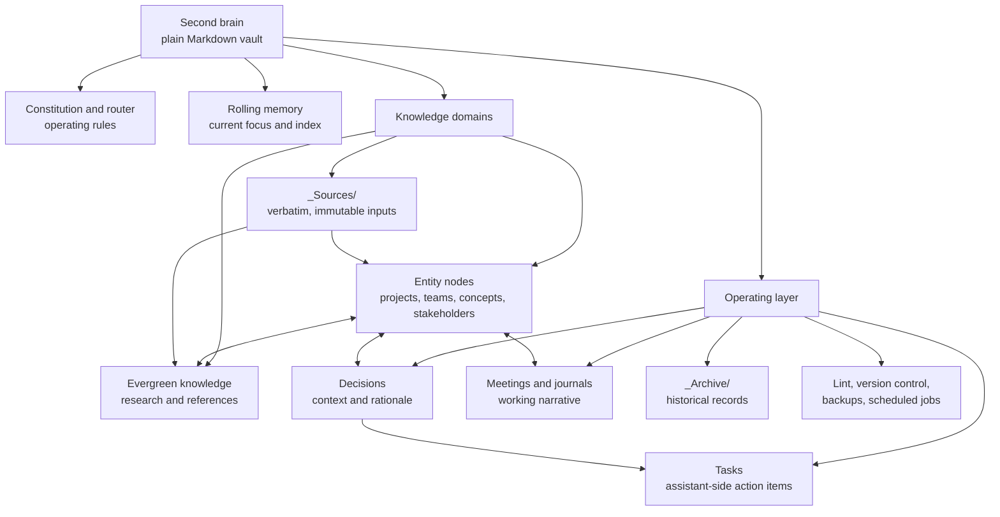
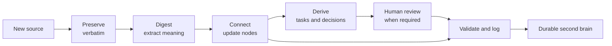
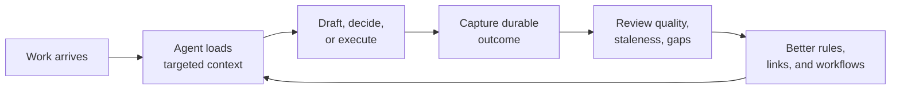

LLMs are excellent at reasoning, but they are poor at continuity. A new session can be brilliant and still begin with no understanding of the decisions, relationships, constraints, and unfinished threads that shaped the previous one.

A second brain addresses that gap. It is not a larger notes folder, a chatbot memory toggle, or a search index over old documents. It is a durable context system: a structured body of knowledge, operating rules, and repeatable workflows that an AI agent can read, update, and use to help with work over time.

The important shift is from asking an AI to remember everything to giving it a maintained environment in which the right context can be found, checked, connected, and acted on. The result is a system that makes work easier to resume, easier to reason about, and less dependent on repeatedly reconstructing the past.

## Contents

- [The Promise of a Second Brain](#the-promise-of-a-second-brain)
- [What a Second Brain Is](#what-a-second-brain-is)
- [Prior Art and Alternatives](#prior-art-and-alternatives)
- [The Architecture: A Graph with an Operating Layer](#the-architecture-a-graph-with-an-operating-layer)
- [How the Workflows Operate](#how-the-workflows-operate)
- [How the System Grows](#how-the-system-grows)
- [Productivity Gains and Measurement](#productivity-gains-and-measurement)
- [Guardrails, Performance, and Trust](#guardrails-performance-and-trust)
- [Limitations and Future Work](#limitations-and-future-work)
- [FAQ](#faq)
- [Getting Started](#getting-started)

## The Promise of a Second Brain

Most knowledge work has a hidden tax: context assembly. Before making a decision, drafting a document, preparing for a conversation, or continuing an unfinished task, you must reconstruct what matters. That reconstruction happens across tabs, messages, documents, bookmarks, memory, and fragments of earlier conversations.

The cost is not only time. Context switching creates uncertainty. Important constraints disappear from view. Decisions get revisited because their rationale is hard to find. An AI assistant may produce a polished answer that misses the history behind the request.

A second brain changes the starting point. Instead of opening a blank chat, an agent can begin from a small set of durable instructions, current working memory, linked entities, and preserved sources. It can answer questions such as:

- What is this thing?
- What has changed since the last time it was discussed?
- Which decisions affect it?
- What source supports this claim?
- What work is waiting, and who or what is it connected to?
- What should happen next?

That creates four practical benefits:

1. **Faster cold starts.** A session spends less time rediscovering the shape of the problem.
2. **Lower cognitive load.** The human does not need to carry every open loop in working memory.
3. **More consistent follow-through.** Actions and decisions have explicit destinations instead of disappearing into chat history.
4. **Compounding context.** Each useful session improves the environment available to the next session.

This is not a promise of perfect automation. The system does not eliminate judgment. It moves judgment to a better place: deciding what is durable, what is provisional, what is actionable, and what requires human approval.

## What a Second Brain Is

A useful definition is:

> A second brain is a durable, inspectable context layer that combines structured knowledge, provenance, operating rules, and workflows so an AI agent can provide continuity across sessions.

Each part of that definition matters.

- **Durable** means the context lives outside one conversation.
- **Inspectable** means a human can open the files and understand what the system believes.
- **Structured** means related information has predictable locations and metadata.
- **Provenance** means important claims can be traced back to their source.
- **Operating rules** tell the agent how to behave.
- **Workflows** describe how information enters, changes, and leaves the system.

The system is therefore more than a collection of notes. It has three distinct layers:

1. **Sources** are received inputs. They remain as close to verbatim as practical.
2. **Knowledge** is the maintained interpretation: entities, concepts, summaries, and relationships.
3. **Operations** are the moving parts that turn context into action: tasks, decisions, schedules, logs, and maintenance.

It also helps to define the terms used throughout this article:

- A **node** is a Markdown file representing one durable concept or entity.
- A **relationship** is a link between nodes, usually expressed with a `[[wikilink]]`.
- **Frontmatter** is typed metadata at the top of a file, such as `type`, `status`, `source`, or `updated`.
- A **workflow** is a repeatable sequence for a class of work.
- An **agent** is an AI system that can reason and use tools, not only generate text.
- The **operating layer** is the set of files and routines that keep the knowledge layer useful.

The storage format can remain deliberately boring. Plain Markdown, YAML frontmatter, normal folders, and Git provide enough structure for a surprisingly capable system. The [Obsidian documentation for properties](https://help.obsidian.md/properties) is a useful reference for the broader idea of typed metadata, but the design does not need to be coupled to Obsidian. Any editor that handles text can participate.

## Prior Art and Alternatives

The second brain idea has a long history. Personal knowledge management systems, wikis, outliners, folder taxonomies, and search tools all solve parts of the problem. LLMs and agents change the economics because they can maintain relationships and perform the repetitive work of organizing information.

### PARA: Useful Filing, Weak Agent Context

The [PARA method](https://fortelabs.com/blog/para/) organizes information into Projects, Areas, Resources, and Archives. It is attractive because it is easy to explain and gives every note a broad destination.

Its limitation appears when one subject spans several categories. A person, project, decision, and meeting may all be connected, but their context gets scattered across lifecycle folders. A human can follow those trails with effort. An agent can do it too, but every query becomes a context-assembly exercise.

The second brain described here organizes primarily by **what a thing is**, not by its current lifecycle. A project has one stable home. A stakeholder has one stable home. A source has one provenance-preserving home. Lifecycle still matters, but it becomes metadata such as `status: active`, `status: historical`, or `status: archived`, rather than the main filing logic.

PARA remains useful for a personal archive or a simple starting point. An entity graph becomes more useful when continuity and relationships matter more than filing speed.

### Karpathy’s LLM Wiki: The Maintained Knowledge Layer

Andrej Karpathy’s [LLM Wiki gist](https://gist.github.com/karpathy/442a6bf555914893e9891c11519de94f) describes a closely related pattern: preserve raw sources, let an LLM maintain an interlinked Markdown wiki, and give the agent a rules file that explains how to ingest and update it.

That pattern contributes an important insight. Retrieval alone is not enough. A system becomes more valuable when new information is integrated into an existing body of knowledge, contradictions are surfaced, and pages remain current instead of accumulating disconnected summaries.

The design here extends that idea into an operating system for work. It adds explicit task and decision routing, approval boundaries, scheduled maintenance, change history, validation, backups, and a distinction between stable domains and fast-moving operations.

### Flat Notes, Vector Search, and Chat History

Flat notes are easy to start with, but they rely heavily on the author remembering where something was placed. Vector search can retrieve semantically similar text, but similarity is not the same as identity, authority, or current state. Chat history preserves conversation, but it is a poor task manager and an awkward knowledge graph.

These approaches are not mutually exclusive. Search can help find candidate context. Embeddings may become useful at larger scale. Chat history remains a source of evidence. The key design decision is to make durable, human-readable Markdown the canonical layer rather than hiding the system behind an opaque retrieval service.

## The Architecture: A Graph with an Operating Layer

The system has two complementary structures:

- **Knowledge domains** contain stable context.
- **Operating areas** contain fast-moving activity and system mechanics.

The following diagram shows the relationship. It is intentionally generic: the point is the shape of the system, not the names of any particular domain.



The router is the entry point. It explains where things live, which conventions apply, and which rules are non-negotiable. It should remain short. A router that becomes a giant encyclopedia defeats its own purpose.

Rolling memory is also intentionally narrow. It holds current focus, active threads, recent decisions, and pointers to durable facts. It is not a second copy of the vault. Its job is to help an agent orient itself quickly before it follows links into deeper context.

### Entity Nodes and Relationships

An entity node uses predictable metadata and a stable section skeleton. A generic project node might look like this:

```yaml
---
type: project
name: Example Project
status: active
owner: "[[Example Stakeholder]]"
related: ["[[Example Team]]", "[[Example Decision]]"]
source: "[[source-document]]"
updated: 2026-08-01
---
```

The body can contain goals, current status, next steps, people involved, and links. The exact fields vary by node type, but consistency is more important than exhaustiveness.

The file should be named after the entity rather than a generic name such as `profile.md` or `overview.md`. Stable names make links resolve predictably and make search results easier to interpret. Aliases can handle alternate spellings without changing the canonical link target.

This is a graph, but it does not require a graph database. The graph emerges from ordinary links. A project can point to a decision. The decision can point to a source. A task can point back to the project. The agent follows those connections when it needs more context.

### Sources and Interpretation Stay Separate

Raw inputs and interpreted knowledge should not be mixed. A source file can preserve the original document, transcript, or message export. The durable nodes can then summarize and connect the relevant information while retaining a backlink to the source.

This separation makes correction possible. If an interpretation changes, the original input remains available. If two sources conflict, the system can record the conflict rather than silently overwriting history.

## How the Workflows Operate

A folder structure becomes a system only when it has repeatable behavior. The most important workflow is ingestion.



The stages are deliberately separate:

1. **Preserve.** Store the source with provenance metadata. Avoid rewriting the evidence.
2. **Digest.** Extract the durable meaning, not every sentence.
3. **Connect.** Update the relevant entity and knowledge nodes.
4. **Derive.** Route actions to the right task location and important choices to the decision log.
5. **Review.** Ask for approval before external messages, administrative actions, or ambiguous changes.
6. **Maintain.** Run validation, record the change, and make the result discoverable.

This workflow prevents a common failure mode: an agent reads something, produces a useful answer, and then leaves no durable trace of what changed.

### Session Start

At the beginning of a session, the agent reads the constitution and router, checks rolling memory, identifies the active thread, and opens only the nodes relevant to the request. This is a context budget strategy. The agent does not need the entire vault in every prompt.

The router answers “where should I look?” Memory answers “what is currently active?” The linked nodes answer “what do I need to know?” That sequence is more reliable than dumping every document into the context window.

### Capture and Ingestion

New information can arrive through a file drop, a message export, a meeting note, a document, or a direct instruction. The ingestion workflow gives each source a stable home, captures its origin, and decides whether it should become a new node or update an existing one.

The agent should prefer updating an existing node when the subject already exists. Otherwise, every new source creates another isolated summary, and the system slowly becomes a pile of duplicated context.

### Actions and Decisions

Tasks and decisions are different kinds of output. A task is something that needs to happen. A decision records what was chosen, why it was chosen, and whether it remains current.

Tasks should be routed by ownership and subject. A global task file can remain narrow and readable, while entity-specific open items live with the relevant node. Decisions should preserve rationale, because the rationale is often more valuable than the conclusion.

External actions require a higher trust threshold than internal drafting. The agent can prepare a reply, a plan, or a change proposal freely. Sending, publishing, deleting, or changing an external system should require explicit permission unless the user has deliberately delegated that authority.

### Maintenance and Wrap-Up

Scheduled maintenance keeps the system from becoming a graveyard. Typical jobs include checking stale tasks, validating links, rotating old logs, identifying unresolved references, and reminding the user about deferred work.

At the end of a session, the agent should summarize what changed, persist durable outputs, route remaining actions, and leave a clear pointer for the next session. The wrap-up is not administrative overhead. It is the mechanism that turns a conversation into compounding context.

## How the System Grows

The system should grow through repeated small improvements, not a one-time attempt to model an entire life or organization.



Every loop should answer one question: what would make the next session easier? Sometimes the answer is a new node. Sometimes it is a better link. Sometimes it is a clearer rule, a narrower task file, or a scheduled check.

The graph becomes more useful as it becomes more connected, but connection density is not the goal. A large number of weak links creates noise. Strong links should explain a meaningful relationship: source, owner, dependency, decision, or next step.

The same principle applies to schemas. Add a field when it supports retrieval, validation, or a recurring decision. Avoid adding metadata because it looks sophisticated. Every field creates maintenance work.

## Productivity Gains and Measurement

The promise of a second brain should be measured through behavior, not enthusiasm. A practical baseline can be collected for two weeks before and after introducing the system.

Track:

- Time from opening a session to producing a useful first draft.
- How often the same background context must be re-explained.
- Number of unfinished actions that survive a session without a destination.
- Time spent locating the source behind an important claim.
- Number of repeated decisions and how often their rationale is recovered.
- Percentage of sessions that end with a clear next step.
- Number of stale, unresolved, or contradictory nodes discovered during maintenance.

These measures reveal whether the system is reducing friction or merely creating more files. A second brain is working when it makes the next action clearer, not when its directory tree becomes impressive.

It is also useful to measure quality:

- **Retrieval quality:** Did the agent find the relevant node?
- **Freshness:** Was the information current enough for the decision?
- **Provenance:** Could the claim be traced to a source?
- **Routing accuracy:** Did the task or decision land in the right place?
- **Human control:** Were approval boundaries respected?

The metrics do not need to be perfect. A lightweight weekly review can reveal whether the system is helping, where it is accumulating debt, and which workflow deserves improvement next.

## Guardrails, Performance, and Trust

A second brain contains concentrated context, so trust and security must be designed in from the beginning.

- **Minimize collection.** Store only the context needed for the declared purpose.
- **Separate sensitive domains.** Do not mix personal, confidential, and general knowledge by accident.
- **Preserve sources carefully.** Treat raw inputs as immutable records when their provenance matters.
- **Use least privilege.** Reading a system and changing it are different permissions.
- **Confirm external actions.** Drafting is not sending; planning is not executing.
- **Version important changes.** Git or an equivalent history makes the system auditable and recoverable.
- **Validate structure.** Check for broken links, duplicate filenames, invalid metadata, and missing required fields.
- **Back up securely.** A backup is useful only if it can be restored and its contents remain protected.

Performance also matters. The agent should not read the entire vault for every task. A router, an index, predictable node names, and targeted search keep context small. Start with ordinary text search and explicit links. Add embeddings, a database, or a specialized index only when measurement shows that the simpler approach has become a bottleneck.

The most important performance optimization is semantic: store durable knowledge once, then link to it. Repeating the same background in many files increases both token usage and contradiction risk.

## Limitations and Future Work

This design has real limitations.

1. **It can become stale.** A beautifully structured node is still wrong if nobody updates it.
2. **It can overfit the current workflow.** A schema that reflects today’s needs may become restrictive later.
3. **It can accumulate duplication.** Agents need explicit rules for updating existing nodes instead of creating near-duplicates.
4. **It can create false confidence.** A polished synthesis is not automatically true.
5. **It requires maintenance.** The operating layer is part of the system, not an optional afterthought.

Future improvements may include stronger freshness signals, contradiction reports, change-impact analysis, better temporal modeling, and automated quality checks. A semantic search index may help at larger scale, but it should remain an acceleration layer over inspectable source files.

The design should evolve through observed failure modes. If an agent repeatedly misses a relationship, improve the schema or routing rule. If users stop trusting a summary, expose the provenance and revision history. If maintenance becomes burdensome, automate the repetitive checks before adding more structure.

## FAQ

### Is a second brain the same thing as an AI memory feature?

No. A memory feature may store selected facts or preferences. A second brain is a complete operating context with sources, relationships, workflows, decisions, and maintenance. Memory can be one component, but it does not replace the system.

### Do I need a vector database?

Not at the beginning. A well-structured Markdown graph, predictable filenames, an index, and text search can work surprisingly well at moderate scale. Add semantic retrieval when measurement shows that explicit navigation and search no longer meet the need.

### Should the AI own all the files?

The AI can perform much of the maintenance, but ownership should be bounded by policy. It can draft and organize. Human approval should remain required for sensitive changes, external actions, destructive operations, and ambiguous interpretations.

### How do I avoid turning the system into a filing project?

Start with one recurring pain point. Add only the nodes, fields, and workflows that reduce that pain. Measure whether the next session becomes easier. If a structure does not improve retrieval, decision-making, or follow-through, remove it or stop expanding it.

### What is the smallest useful version?

Use one router file, one rolling-memory file, a few entity folders, a source folder, a narrow task file, and one ingestion workflow. Plain Markdown is enough. The system becomes valuable through repeated use and refinement, not through an elaborate initial scaffold.

## Getting Started

A practical adoption sequence is:

1. Choose a narrow domain and write a short router that explains its scope and rules.
2. Create a source area, a few entity-named Markdown nodes, and an index of active threads.
3. Define one ingestion workflow: preserve the source, digest the meaning, connect the nodes, and route actions.
4. Add explicit approval boundaries before connecting the agent to external systems.
5. Add validation, version history, and backups before the system becomes difficult to replace.
6. Review the system weekly and improve the rule or workflow that caused the most friction.

The enduring idea is simple: an AI agent becomes more useful when it has a reliable place to stand. A second brain gives it that place without hiding the mechanism behind an opaque service. It turns context into infrastructure, conversations into durable work, and repeated interactions into a compounding advantage.
