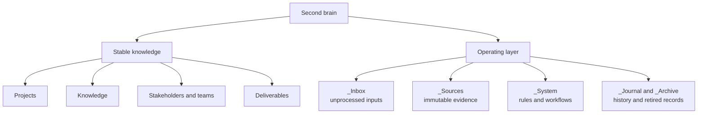
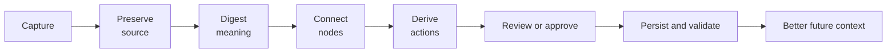
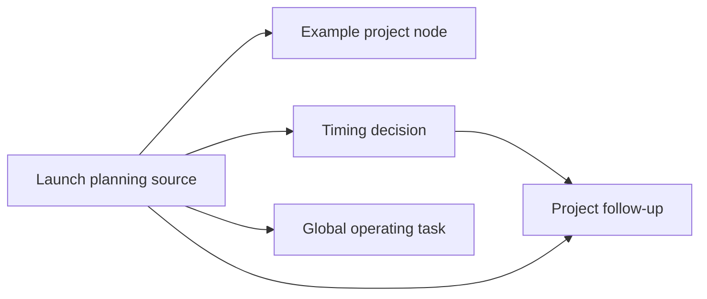

The [first article](https://lirantal.com/blog/building-second-brain-llms-ai-agents) explained why a second brain is useful: it gives an AI agent durable context instead of asking every session to start from a blank page. This article focuses on the harder question: what does the system actually look like, and how does it operate day to day?

The answer is deliberately practical. The foundation is a folder of Markdown files, predictable filenames, YAML frontmatter, links between related notes, and a small set of operating rules. Around that foundation sit workflows for ingesting sources, routing actions, recording decisions, maintaining freshness, and protecting the data.

The goal is not to create the most elaborate knowledge-management system. The goal is to create a small operating environment that an agent can navigate reliably, a human can inspect easily, and both can improve over time.

## Contents

- [The Design in One Sentence](#the-design-in-one-sentence)
- [Start with a Small Vault](#start-with-a-small-vault)
- [Create the Constitution and Router](#create-the-constitution-and-router)
- [Separate Domains from Operations](#separate-domains-from-operations)
- [Model Knowledge as Nodes](#model-knowledge-as-nodes)
- [Define Lifecycles Without Moving Everything](#define-lifecycles-without-moving-everything)
- [Run the Core Workflows](#run-the-core-workflows)
- [Route Actions and Decisions](#route-actions-and-decisions)
- [Maintain the System](#maintain-the-system)
- [Build a Practical Example](#build-a-practical-example)
- [Trust Is a Design Constraint](#trust-is-a-design-constraint)
- [Where the System Starts to Drift](#where-the-system-starts-to-drift)
- [A Sensible Build Order](#a-sensible-build-order)
- [FAQ](#faq)

## The Design in One Sentence

The design is an **entity-oriented Markdown graph with an explicit operating layer**.

That phrase contains several decisions:

- **Entity-oriented** means a durable subject has one stable home. A project, concept, stakeholder, or team is not scattered across folders merely because its status changes.
- **Markdown graph** means nodes are plain files connected with `[[wikilinks]]`, with YAML frontmatter carrying typed metadata.
- **Explicit operating layer** means the system includes files and routines for memory, tasks, decisions, sources, logs, archives, validation, and scheduled maintenance.

This differs from a folder of notes because the structure is designed for an agent. The agent needs to know where to look, how to recognize a node, how to distinguish evidence from interpretation, where to put a task, and when it must ask for approval.

It also differs from a generic AI memory feature. Memory may store a few facts. A second brain defines a durable environment in which facts, relationships, history, and workflows can be inspected and updated.

## Start with a Small Vault

The smallest useful version does not need dozens of folders. Begin with a few stable concepts and an operating core:

```text
second-brain/
├── CLAUDE.md
├── MEMORY.md
├── TASKS.md
├── DECISIONS.md
├── CHANGELOG.md
├── README.md
│
├── _System/
│   ├── conventions.md
│   ├── glossary.md
│   ├── templates/
│   └── workflows/
├── _Inbox/
├── _Sources/
├── _Journal/
├── _Archive/
│
├── Projects/
├── Stakeholders/
├── Teams/
└── Knowledge/
```

The exact domain names can change. Keep stable knowledge domains separate from underscore-prefixed operating areas, which hold transient inputs, logs, rules, and maintenance artifacts. Start with the domain that creates the most repeated context work. Add another only when a recurring relationship makes the boundary clear.

### The Root Files

Each root file has one job:

- `CLAUDE.md` is the constitution and router. It explains scope, rules, and where things live.
- `MEMORY.md` is rolling working memory. It points to active threads and recent context.
- `TASKS.md` holds only tasks that belong in the global operating queue.
- `DECISIONS.md` records important choices and their rationale.
- `CHANGELOG.md` records what changed in the vault.
- `README.md` helps a human understand the system without reading every rule.
- `SECOND-BRAIN-DESIGN.md`, if maintained, describes the architecture itself.

The single-responsibility rule matters. If the router becomes a knowledge base or the task file mirrors every external tracker, both become harder to use.

## Create the Constitution and Router

The first file an agent should read is the router. It is the system’s contract.

A practical router answers:

- What is the scope of this vault?
- What should the agent read at the beginning of a session?
- Where do projects, sources, decisions, and tasks live?
- Which actions require approval?
- What must be persisted?
- What conventions govern filenames, metadata, and links?
- Which external systems remain authoritative?

Keep the root rules short enough to review regularly. Add a local `CLAUDE.md` only where a domain genuinely needs different behavior. The router should define the trust boundary: drafting is different from sending, modifying an external record, or deleting data. The more specific the policy, the less the agent must infer.

## Separate Domains from Operations

The design uses two layers because stable knowledge and fast-moving activity have different lifecycles.

### Stable Knowledge Domains

Stable domains contain nodes that should remain findable even when their current status changes. Examples include:

- projects and initiatives,
- concepts and research,
- teams and roles,
- stakeholders and relationships,
- reusable references,
- public or internal deliverables.

Each subject should have one canonical home. A project can have a `status: historical` field without being moved into a lifecycle archive. A concept can be superseded without losing its original location.

This is the practical difference between organizing by entity and organizing by lifecycle. Lifecycle becomes metadata and history, while identity remains stable.

### The Operating Layer

The operating layer handles movement:

- `_Inbox/` receives unprocessed material.
- `_Sources/` preserves raw inputs.
- `_Journal/` captures daily narrative.
- `_Archive/` stores retired or completed records.
- `_System/` contains conventions, templates, prompts, and workflows.

Stable domains answer “what is this?” The operating layer answers “what should happen next?”



## Model Knowledge as Nodes

The graph model is useful only when nodes are predictable. Every node type should have:

1. A stable filename.
2. A small set of required frontmatter fields.
3. A consistent section skeleton.
4. Links to related nodes.
5. A clear rule for where new information should be added.

### Name Files After Their Subjects

Prefer:

```text
Projects/
└── Example-Project/
    └── Example-Project.md
```

Avoid generic names such as `profile.md`, `overview.md`, or `notes.md` for canonical nodes. Generic basenames create collisions and make links ambiguous as the vault grows.

If a subject has alternate names, put them in `aliases`. Keep the link target equal to the literal filename so editors and tools that resolve links by filename behave consistently. Display labels can remain human-friendly:

```markdown
[[Example-Project|Example Project]]
```

### Use Typed Frontmatter

A generic project node can start with this small schema:

```yaml
---
type: project
name: Example Project
status: active
involvement: owned
owner: "[[Example-Stakeholder]]"
related: ["[[Example-Team]]", "[[Example-Decision]]"]
source: "[[2026-08-01-launch-note]]"
created: 2026-08-01
updated: 2026-08-01
---
```

The metadata supports routing and validation. Add fields only when they help an agent find, filter, validate, or connect the node.

The [Obsidian properties documentation](https://help.obsidian.md/properties) explains the general value of typed note metadata. The design remains editor-agnostic: frontmatter and Markdown should be readable in any text editor.

### Use Consistent Section Skeletons

A project node might use:

```markdown
## Summary

## Goals and Success Metrics

## Status and Next Steps

## Related Work

## Sources
```

A meeting node might use:

```markdown
## Context

## Discussion

## Decisions

## Action Items

## Sources
```

### Keep Sources Immutable

A source node represents evidence received from somewhere else. Its frontmatter should describe provenance rather than interpretation:

```yaml
---
type: source
from: meeting-notes
received: 2026-08-01
original_url: https://example.invalid/source
original_format: markdown
immutable: true
digested_into: ["[[Example-Project]]", "[[Example-Decision]]"]
---
```

The body should remain verbatim or as close to verbatim as practical. Interpretation belongs in entity and knowledge nodes, which link back to the source.

This creates a two-step audit trail:

```text
source evidence → interpreted node → task or decision
```

If an interpretation changes, the evidence remains available. If sources disagree, the system can preserve the disagreement instead of silently replacing one claim.

## Define Lifecycles Without Moving Everything

Stable identity and changing state should not be confused.

### Live Nodes and Historical Snapshots

A live node represents the current understanding of a subject. A snapshot represents a frozen point in time. When a major state transition occurs, preserve the old state in a `_History/` folder or equivalent archive:

```yaml
---
type: snapshot
status: historical
authoritative: false
as_of: 2026-08-01
captured: 2026-08-01
superseded_by: "[[Example-Project]]"
source: "[[2026-08-01-transition-note]]"
---
```

The live node points to the snapshot. The snapshot does not feed current state back into the live node. This one-way relationship prevents historical context from being mistaken for current truth.

### Workstreams and Drafts

An active, uncertain initiative can use a workstream folder:

```text
Projects/
└── Example-Project/
    ├── Example-Project.md
    └── Workstream/
        ├── README.md
        └── draft-direction.md
```

Draft nodes can evolve without pretending to be settled. When the direction becomes durable, useful content graduates into the canonical node.

### Deliverables and Prompts

An agent-created deliverable should be persisted as a file and placed with the subject it serves. A reusable prompt is a different type of artifact: it belongs in `_System/prompts/`, with metadata describing when it should be used and what inputs it expects.

This prevents received sources from being confused with authored deliverables and reusable workflow instructions from being buried in one-off conversations.

## Run the Core Workflows

A directory becomes an operating system when it has repeatable workflows. The core loop is:



### 1. Start Every Session with Orientation

The session-start workflow should be short and deterministic:

1. Read the root router.
2. Read rolling memory.
3. Identify the active request or thread.
4. Search for the relevant canonical nodes.
5. Read only the context required for the current task.
6. Check whether any existing task or decision already covers the request.

This creates a context budget: the agent loads a map first, then follows links instead of reading the entire vault every time.

### 2. Put Raw Material in the Inbox

The inbox is a staging area, not a permanent category. A new document, transcript, exported message, or capture can arrive there without requiring an immediate filing decision.

An inbox workflow should:

1. Identify the source and its provenance.
2. Decide whether it is useful, duplicate, or noise.
3. Preserve the raw material in `_Sources/` when it matters.
4. Digest durable information into existing nodes.
5. Create a new node only when the subject does not already exist.
6. Route actions and decisions.
7. Link the result back to the source.
8. Clear or archive the processed inbox item.

The inbox reduces capture friction while keeping the long-term graph clean.

### 3. Ingest with Preserve → Digest → Derive

This is the main source-ingestion contract:

- **Preserve** what arrived.
- **Digest** what should become durable knowledge.
- **Derive** what should become action or decision.

The order matters. If an agent starts by rewriting the source into a summary, it may lose the evidence needed to correct the summary later. If it writes tasks without linking them to the originating source, the action becomes difficult to audit.

### 4. Use Approval-First Drafting

A draft workflow should make the boundary explicit:

```text
request → draft → human review → external action
```

The agent can write a proposed response, prepare a change, or organize a plan. Sending, publishing, deleting, or changing an external system should require approval unless the user has explicitly delegated that action.

Approval increases autonomy without making trust binary: internal preparation can be fast while external side effects remain controlled.

### 5. Schedule Repetitive Work

Strong workflows can become scheduled jobs. Examples include:

- a morning brief,
- a weekly review,
- task grooming,
- stale-node detection,
- inbox processing,
- deferred-work reminders,
- meeting-note digestion,
- a session wrap check.

Every scheduled job needs an explicit output and permission boundary. Its work should be recorded in the same system it maintains.

### 6. Wrap the Session

The wrap workflow is the final integrity check:

1. What durable knowledge was learned?
2. Which nodes changed?
3. Which tasks were created, completed, or deferred?
4. Which decisions need to be recorded?
5. Which sources support the changes?
6. What should the next session read first?

Without a wrap step, good work can leave the next session with no useful trail.

## Route Actions and Decisions

A task and a decision are not interchangeable.

### Keep the Global Task Queue Narrow

The global task file should contain only:

- actions the user or assistant must drive directly,
- genuine operations with no better subject home,
- waiting items that need follow-up,
- deferred or scheduled work,
- recurring maintenance,
- a short, useful record of recently completed items.

Subject-specific tasks should live with the subject. A project’s next step belongs in its status section. An open question about a stakeholder belongs in that node’s open-items section. This keeps the global queue readable.

External delivery systems should remain authoritative for delivery work. The second brain can link to them and record context, but it should not mirror every ticket or backlog item.

### Record Decisions as ADR-Lite Notes

The decision log preserves:

- date,
- decision,
- context,
- rationale,
- source,
- status.

Useful statuses include `proposed`, `decided`, and `superseded`. A decision remains valuable after it is reversed because the rationale explains why the earlier choice made sense at the time.

### Groom Completion

Completed tasks should not remain forever in the active view. A weekly grooming workflow can move closed items into an append-only archive, keep only a short recent history in the main file, and flag active items that have gone stale.

Recurring tasks need a cadence and a last-completed date rather than a checkbox that can never reach a final state:

```text
Review source freshness
cadence: weekly
last done: 2026-08-01
```

The purpose is signal quality: an active list full of closed or stale items hides what matters now.

## Maintain the System

The operational controls turn a folder of notes into a durable system.

### Version Every Logical Change

Commit logical change sets with a message that explains what changed. The [Git documentation](https://git-scm.com/book/en/v2) covers the underlying model, but the design principle is simple: history should make it possible to understand and recover the evolution of the vault.

A save command can standardize the sequence:

```text
lint → stage → commit → record in changelog
```

One logical change per commit makes review and recovery easier. Avoid committing secrets, temporary exports, or unreviewed generated files.

### Validate Structure Before Commit

An integrity check should block commits for errors such as:

- broken or newline-split `[[wikilinks]]`,
- duplicate canonical basenames,
- missing required fields on project nodes,
- malformed frontmatter,
- invalid lifecycle states.

Warnings can identify unresolved links or stale metadata without blocking all work. The exact policy can vary, but the distinction between errors and warnings should be explicit.

### Back Up with Recovery in Mind

A backup is not complete when an archive exists. It is complete when:

1. the archive is encrypted,
2. the password is not stored beside it,
3. the restore procedure is documented,
4. a restore test has succeeded,
5. the backup location is separate from the live vault.

The restore instructions should work even if the helper script is unavailable. Durability depends on the recovery path, not the archive filename.

### Handle Parallel Agents Carefully

Multiple sessions can write concurrently. A simple mutex or serialized save operation reduces collisions, but it does not remove the risk of two sessions editing the same file.

The safest defaults are:

- commit promptly,
- keep change sets small,
- avoid two agents editing one node simultaneously,
- use path-specific staging or isolated worktrees when concurrency grows,
- inspect the diff before committing.

Automation should make the common path safe without pretending concurrent writes are free.

## Build a Practical Example

Consider a generic launch-planning note that arrives in the inbox. The source mentions a project, a decision about timing, and two follow-up actions.

The system processes it like this:

1. Save the original note as `_Sources/2026-08-01-launch-planning.md`.
2. Add a provenance header and mark it immutable.
3. Update `Projects/Example-Project/Example-Project.md` with the new status.
4. Create or update `Decisions/2026-08-01-timing.md`.
5. Route the two actions to the project node or global task file based on ownership.
6. Add source backlinks to the project, decision, and tasks.
7. Append a short change entry to `CHANGELOG.md`.
8. Run the integrity check.
9. Commit the logical change set.

The result is not a single giant summary. It is a small connected graph:



Later, an agent asked about the project can read the project node, follow the decision link, inspect the source, and identify the outstanding actions. It does not need to search every transcript from scratch.

## Trust Is a Design Constraint

A second brain becomes more useful as it connects to more of your work. That also makes mistakes more consequential. The design therefore needs a clear opinion about what deserves to be remembered, what should remain temporary, and what the agent may change on its own.

Selective memory is a feature. A long source may contain only a few details worth carrying into the knowledge graph. Preserve the original when provenance matters, but digest only what serves the work. Sensitive domains can live separately or remain outside the vault entirely. Otherwise, a helpful context system can quietly become an indiscriminate profile of everything it can access.

Provenance creates a practical kind of trust. A summary linked to its source can be checked, corrected, and judged for freshness. A decision marked `proposed` means something different from one marked `confirmed`. Those small distinctions make the graph easier to trust without pretending that every synthesis is authoritative.

Autonomy also needs a visible edge. An agent can reorganize notes, prepare drafts, and suggest changes with little risk. Sending a message, publishing a document, deleting data, or modifying an external system deserves an explicit approval rule. This does not require a grand governance framework. A few concrete boundaries usually work better than a vague instruction to be careful.

## Where the System Starts to Drift

Most second brains do not fail because their graph is too small. They fail because growth erodes the distinctions that made the system useful in the first place.

One early sign is that the map starts competing with the territory. The router grows into an encyclopedia, while the global task file absorbs work that belongs to projects and stakeholders. Both files become comprehensive and less useful. The router should remain a map, and the global queue should contain only work that truly has no better home.

Identity can become fuzzy too. Generic filenames such as `profile.md` and `overview.md` eventually collide, and edited source files blur the line between evidence and interpretation. Entity-named nodes and immutable sources may feel fussy at first, but they prevent subtle confusion once the vault has enough history to matter.

The last form of drift is invisible automation. A scheduled job can process an inbox or update several nodes correctly, yet leave the next session unable to explain what happened. A small completion record, source backlink, or changelog entry is usually enough. The goal is not heavy observability. It is leaving a trail that a person or another agent can follow.

These problems share a pattern: convenience removes a boundary, and the system becomes harder to reason about. When that happens repeatedly, change the rule or workflow that allowed it. The design should evolve from observed failures rather than from an attempt to anticipate every future use.

## A Sensible Build Order

Build the system in layers:

1. **Define scope.** Decide what the vault includes and excludes.
2. **Write the router.** Explain where things live and which actions require approval.
3. **Create the operating core.** Add memory, tasks, decisions, changelog, inbox, sources, archive, and system folders.
4. **Choose one domain.** Create a small set of entity-named nodes.
5. **Add templates.** Standardize frontmatter and section skeletons for recurring node types.
6. **Implement one ingestion workflow.** Preserve, digest, connect, derive, review, and maintain.
7. **Add validation.** Block broken links and malformed structure before commits.
8. **Add backups.** Test the restore path before the vault becomes irreplaceable.
9. **Schedule maintenance.** Groom tasks, check freshness, and process recurring inputs.
10. **Review the design.** Keep what reduces friction and remove what does not.

Do not begin by building a search platform. Start by making the files legible and the workflows reliable. Search, embeddings, and databases can be added later as acceleration layers.

## FAQ

### Does this require a specific editor?

No. Plain Markdown, YAML frontmatter, and standard links work in many editors. Tools that render wikilinks can improve navigation, but the files should remain readable without a specialized application.

### Why use both a source file and a knowledge node?

They serve different purposes. The source preserves evidence. The knowledge node provides an updated, connected interpretation. Combining them makes correction and provenance harder.

### How much metadata should a node have?

Enough to support routing, validation, and retrieval. Start with `type`, `name`, `status`, relationships, source, and timestamps. Add fields only when a recurring workflow proves that they are useful.

### When should a node become a snapshot?

Create a snapshot when a historical state needs to remain available but must no longer be mistaken for current truth. Use a one-way link from the live node to the snapshot.

### Is this the same as the LLM wiki pattern?

It builds on that pattern. The [LLM Wiki specification](https://gist.github.com/karpathy/442a6bf555914893e9891c11519de94f) emphasizes immutable sources, an agent-maintained Markdown wiki, and a rules file. This design adds stronger task routing, decision history, approval boundaries, validation, backup, and scheduled maintenance.

### What should be automated first?

Automate repetitive, low-risk work: link checks, task grooming, inbox triage, source preservation, changelog entries, and freshness reminders. Keep ambiguous interpretation and external side effects reviewable.

## Closing Checklist

Before calling the system operational, verify that:

- the router explains scope, destinations, and approval rules;
- every canonical node has a predictable name;
- frontmatter and section skeletons are consistent;
- raw sources remain separate and traceable;
- tasks have clear homes and do not mirror an external backlog;
- decisions preserve context and rationale;
- workflows define their inputs, outputs, and completion records;
- validation catches structural errors;
- backups can be restored;
- scheduled jobs leave an audit trail;
- a session wrap leaves the next session with a useful starting point.

A second brain becomes practical when these rules become habits. The magic is not in the folder names. It is in the discipline of preserving evidence, maintaining relationships, routing work, and making every session leave the system more useful than it found it.
